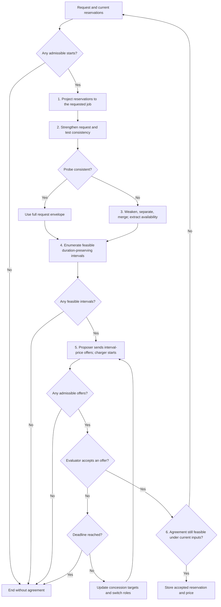
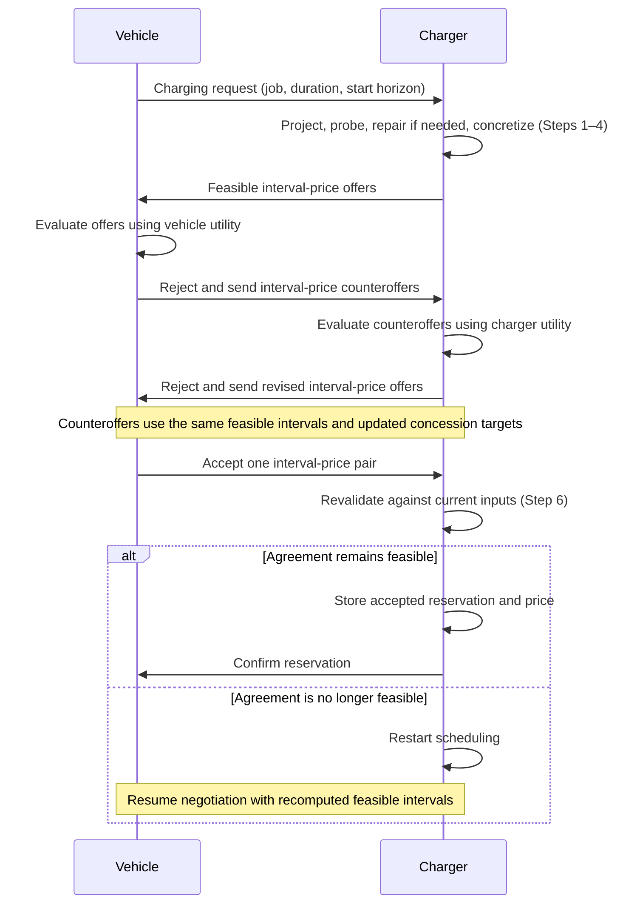

# Contract protocol

The protocol turns a flexible EV charging request into an agreement on one
charging interval and its price. It first checks the request against existing
reservations, repairs the available time region when necessary, and enumerates
feasible intervals of the requested duration. The EV and charger then bargain
over these alternatives. Only an accepted agreement updates the reservations.

The economic stage adapts the alternating-offer mechanism of
[Khan et al. (2020), *Price and Time-Slot Negotiation Protocol for EVs Charging
in Highly Congested Distribution Networks*](https://digibuo.uniovi.es/dspace/handle/10651/58047).
Here, **alternating offers** means that the charger proposes a set of
interval-price pairs, the EV evaluates them using its own utility, and a
rejection switches the proposer and evaluator roles. Each party concedes
toward its minimum acceptable utility as the deadline approaches. Negotiation
ends in acceptance or without agreement. We use the charger as the negotiating
counterpart to the EV; Khan et al. use an aggregator.

The scheduling stage uses separation and merging, following the repair
approach of [Mallozzi et al., *Contract-Based Specification Refinement and
Repair for Mission Planning*](https://arxiv.org/abs/2211.11908).
Our reservation representation, strengthened probe, and duration-preserving
offer generation specify how that approach is used here. Bargaining selects
among the resulting feasible intervals; price rejection leaves this set fixed.

The message exchange below illustrates agreement after one counteroffer from
each party. Either party may accept a received offer earlier; further
rejections repeat the exchange until acceptance or termination. The flowchart
above includes the cases where no feasible interval or admissible offer exists.

## Inputs and notation

Consider one charging point with signal $\textit{job}:X\to\mathbb N_0$;
$0$ denotes an unallocated point. EV $i$ requests a new job $k>0$, duration
$d>0$, and start horizon $h\geq0$. Existing reservations are consistent and
belong to other job IDs. The scheduling model permits allocation wherever
no reservation blocks it; additional physical constraints require the
trajectory feasibility check described below.

Use the temporal syntax and satisfaction relation of [LOGIC.md](LOGIC.md):
$\lozenge_\rho$ for eventually, $\square_\rho$ for always, and $d$ for the
relative window $[0,d)$. Charging throughout a duration is a condition
$\square_d\varphi$. Evaluate all contracts at anchor $0$, with represented
time $\mathbb I$ containing $0$, the full request envelope, and all reservation
intervals.

The start-grid policy and its envelope are

$$
\begin{aligned}
I&:=\left\{\frac{n}{10}:n=1,\ldots,\lfloor10h\rfloor\right\},\\
J_s&:=[s,s+d),\qquad s\in I,\\
E&:=\bigcup_{s\in I}J_s=I\oplus[0,d).
\end{aligned}
$$

The horizon bounds starts, not completion times. To keep LOGIC.md's
interval-only temporal parameters, notation over a finite union
$S=\bigcup_{\ell=1}^m S_\ell$ abbreviates

$$
\lozenge_S\varphi:=\bigvee_{\ell=1}^m\lozenge_{S_\ell}\varphi,
\qquad
\square_S\varphi:=\bigwedge_{\ell=1}^m\square_{S_\ell}\varphi.
$$

Each $S_\ell$ is an absolute interval, including singleton intervals for
the start grid. Empty unions give $\bot$ and $\top$, respectively.

Write $C=\langle A\mid G\rangle$ for an assume-guarantee contract,
$\bullet$ for contract merging, and $\div$ for separation. These operate
on contracts whose formulas use LOGIC.md. For unconditional contracts,
merging conjoins guarantees. Consistency of $\langle\top\mid G\rangle$
means that some admissible trajectory satisfies $(\xi,0)\models G$.

The request is

$$
\boxed{
C^{\mathrm{req}}
:=\left\langle\top\;\middle|\;
\lozenge_I\square_d(\textit{job}=k)\right\rangle.
}
$$

If $I=\varnothing$, terminate without agreement.

## 1. Project stored reservations to the requested job

**Storage design.** Store each accepted allocation as its concrete job ID
and half-open interval. For reservation records
$\mathcal R=\{(k_\ell,R_\ell)\}_{\ell=1}^m$, retain

$$
C^{\mathrm{cmt}}:=\langle\top\mid K\rangle,
\qquad
K:=\bigwedge_{\ell=1}^m\square_{R_\ell}(\textit{job}=k_\ell).
$$

This representation is chosen so that a later request can project the
reservations to unavailability. Let $p$ be the projected proposition meaning
that the point is allocated to the current job $k$. On the positive allocation
atoms used in stored reservations and requests, define

$$
\pi_k(\textit{job}=n):=
\begin{cases}
p,&n=k,\\
\neg p,&n\neq k.
\end{cases}
$$

Apply this replacement inside their temporal conditions and Boolean
combinations. Since $k$ is new, every stored reservation projects to
$\square_{R_\ell}\neg p$. Thus

$$
\boxed{
U:=\bigcup_{\ell=1}^m R_\ell,
\qquad
\bar C^{\mathrm{cmt}}:=\pi_k(C^{\mathrm{cmt}})
=\langle\top\mid\bar K\rangle,
\qquad
\bar K=\square_U\neg p.
}
$$

Projection forgets which other job occupies the point. It is a
reservation-specific abstraction, not an equivalence between
$(\textit{job}=n)$ and $(\textit{job}\neq k)$ in the full signal language.
Keep the original records for final feasibility checks and commitment updates.

## 2. Strengthen the request and probe consistency

**Original requirement: choose one start.** The projected request has guarantee

$$
\bar G^{\mathrm{req}}
=\lozenge_I\square_d p
\equiv\bigvee_{s\in I}\lozenge_{[s,s]}\square_d p
\equiv\bigvee_{s\in I}\square_{J_s}p.
$$

The outer condition chooses a start $s$; the inner condition is re-anchored
at $s$ and requires $p$ throughout $[s,s+d)$.

**Probe requirement: cover every candidate window.** Replace the disjunction
over starts by a conjunction, leaving each duration window unchanged:

$$
\begin{aligned}
\widehat G^{\mathrm{req}}
&:=\square_I\square_d p\\
&\equiv\bigwedge_{s\in I}\square_{J_s}p
\equiv\square_Ep,\\
\widehat C^{\mathrm{req}}
&:=\langle\top\mid\widehat G^{\mathrm{req}}\rangle.
\end{aligned}
$$

For nonempty $I$, $\widehat G^{\mathrm{req}}\Rightarrow\bar G^{\mathrm{req}}$.
The reverse implication does not hold: the probe asks for one trajectory
covering the whole envelope, while the request needs only one full window.
This deliberate strengthening exposes conflicts anywhere in the envelope;
it is temporary and is never stored as a reservation.

Merge with the projected commitments and test:

$$
\begin{aligned}
C^{\mathrm{cand}}
&:=\bar C^{\mathrm{cmt}}\bullet\widehat C^{\mathrm{req}}
=\langle\top\mid\square_U\neg p\land\square_Ep\rangle,\\
C^{\mathrm{cand}}\text{ consistent}
&\quad\Longleftrightarrow\quad E\cap U=\varnothing.
\end{aligned}
$$

- **Success:** set $J:=E$ and proceed to Step 4.
- **Failure:** proceed to Step 3 to remove blocked portions of the envelope.
  This does not yet establish that the original request is infeasible.

For example, with $h=4$, $d=1$, and $U=[1,3)$, the envelope is $E=[0.1,5)$.
The probe fails on $[1,3)$, although the original request can still use
$J_3=[3,4)$.

The intersection criterion is exact for the reservation model above. With
additional dynamics or resource constraints, use satisfiability over
admissible trajectories; disjointness alone only rules out reservation conflicts.

## 3. Repair availability

Relax the probe's continuous coverage to the existence of an available time,
then separate from and merge with the projected commitment:

$$
\begin{aligned}
C^w&:=\langle\top\mid\lozenge_Ep\rangle,\\
C^s&:=C^w\div\bar C^{\mathrm{cmt}},\\
C^{ms}&:=C^s\bullet\bar C^{\mathrm{cmt}}.
\end{aligned}
$$

For $C^{ms}=\langle A^{ms}\mid G^{ms}\rangle$, make its assumption an
explicit requirement in the scheduling query:

$$
C^{\mathrm{post}}
:=\langle\top\mid A^{ms}\land G^{ms}\rangle
=\langle\top\mid\bar K\land\lozenge_Ep\rangle.
$$

The last equality is the specialization of the separation/merging algebra to
these unconditional inputs. Simplify the remaining guarantee using

$$
\square_U\neg p\land\lozenge_Ep
\equiv\square_U\neg p\land\lozenge_{E\setminus U}p.
$$

Extract the availability used for offer generation:

$$
\boxed{
J:=E\setminus U,
\qquad
C^{\mathrm{avail}}:=\langle\top\mid\lozenge_Jp\rangle.
}
$$

Extraction keeps the commitment separately; it does not assert that
$C^{\mathrm{post}}$ and $C^{\mathrm{avail}}$ are equivalent. The relaxed
condition only identifies potential charging times. Step 4 restores the
full duration and start-grid requirements. In the example, $J=[0.1,1)\cup[3,5)$.

## 4. Concretize feasible intervals

For a concrete interval $J'$, use the original job vocabulary:

$$
C_i^{J'}:=\left\langle\top\mid\square_{J'}(\textit{job}=k)\right\rangle.
$$

Both probe branches now enumerate

$$
\boxed{
\mathcal J:=\left\{
J_s=[s,s+d):s\in I,\quad J_s\subseteq J,\quad
C^{\mathrm{cmt}}\bullet C_i^{J_s}\text{ consistent}
\right\}.
}
$$

In the reservation model, containment in $J$ supplies the consistency check.
With additional constraints, check each candidate against the original
commitments and the system's admissible trajectories. Every retained contract
refines $C^{\mathrm{req}}$: it chooses an allowed start and preserves $d$.

A nonempty $J$ can still yield $\mathcal J=\varnothing$ if no full window
fits. In the running example, only starts $s\in\{3,3.1,\ldots,4\}$ survive;
the component $[0.1,1)$ is too short. Terminate if $\mathcal J=\varnothing$;
otherwise pass these alternative contracts to bargaining.

## 5. Negotiate interval-price pairs

Keep $\mathcal J$ fixed during bargaining. Use $q$ for the total price,
$r\in\{0,\ldots,T\}$ for the negotiation round, and $T>0$ for the round
deadline. Price is stored as agreement metadata. The following monetary
utilities are a minimal design choice for this adaptation:

$$
u_i^{\mathrm{EV}}(J',q)=v_i(J')-q,
\qquad
u^{\mathrm{CH}}(J',q)=q-c(J'),
$$

where $v_i$ is the EV's value and $c$ the charger's cost. Each party
$a\in\{\mathrm{EV},\mathrm{CH}\}$ maintains a target
$u^a_{\mathrm{exp},r}$ and a minimum acceptable utility $u^a_{\min}$.

**Propose.** The charger starts. The proposer sends a nonempty burst of
alternatives from $\mathcal J$, with prices targeting its expected utility:

$$
\mathcal O_r\subseteq
\left\{(C_i^{J'},q_r(J')):J'\in\mathcal J\right\},
\qquad
u^{\mathrm{prop}}(J',q_r(J'))\approx u^{\mathrm{prop}}_{\mathrm{exp},r}.
$$

Thus the charger targets $q_r(J')\approx c(J')+u^{\mathrm{CH}}_{\mathrm{exp},r}$,
and the EV targets $q_r(J')\approx v_i(J')-u^{\mathrm{EV}}_{\mathrm{exp},r}$.
Every offer must meet the proposer's utility floor. If no admissible offer
can be generated, terminate without agreement.

**Evaluate.** The other party selects its highest-utility proposal:

$$
(J_r^*,q_r^*)\in
\operatorname*{arg\,max}_{(J',q):(C_i^{J'},q)\in\mathcal O_r}
u^{\mathrm{eval}}(J',q).
$$

Before the deadline, accept when this utility meets both the evaluator's
current target and its minimum. At the deadline, accept if it exceeds the
minimum; otherwise terminate. These thresholds are the stopping policy used
in this draft.

**Concede and counteroffer.** After rejection at $r<T$, update each party's
target using the concession rule, with exponent $\lambda_a>0$:

$$
u^a_{\mathrm{exp},r+1}
=u^a_{\mathrm{exp},r}
-u^a_{\mathrm{exp},r}\left(\frac{r}{T}\right)^{\lambda_a}.
$$

Switch roles and advance to round $r+1$. Utility floors continue to apply
even if targets fall below them. Counteroffers may change both interval and
price within $\mathcal J$. If the request or commitments change, recompute
feasibility before continuing negotiation.

## 6. Validate and store the accepted agreement

For an accepted pair $(J^*,q^*)$, revalidate feasibility under current inputs
and store the reservation in the form required by Step 1:

$$
\begin{aligned}
C_i^{\mathrm{acc}}
&:=C_i^{J^*}
=\left\langle\top\mid\square_{J^*}(\textit{job}=k)\right\rangle,\\
\mathcal R&\leftarrow\mathcal R\cup\{(k,J^*)\},\\
C^{\mathrm{cmt}}&\leftarrow C^{\mathrm{cmt}}\bullet C_i^{\mathrm{acc}}.
\end{aligned}
$$

Perform validation and insertion against the same reservation state; if the
agreement is no longer feasible, restart scheduling. Store $q^*$ alongside
the accepted record. For a later request with a different job ID, this record
projects to $\square_{J^*}\neg p$ and contributes $J^*$ to its unavailable set.
Probe results, repaired availability, and unaccepted offers remain temporary.
