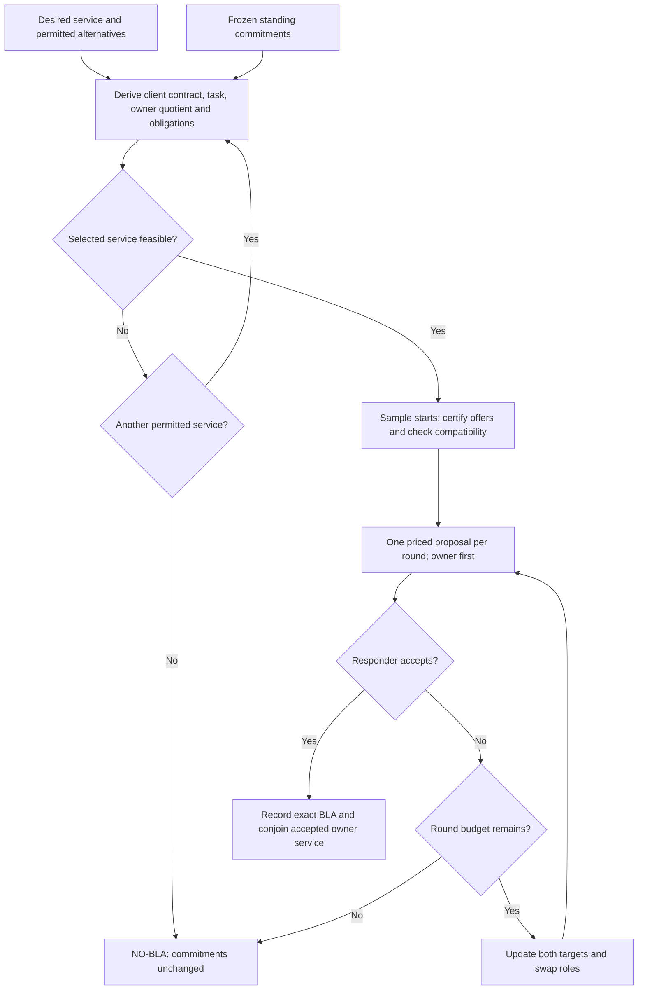

# Contract protocol

[`notebooks/protocol.ipynb`](../notebooks/protocol.ipynb) implements the current
paper's Sections II–III: an owner admits a client's service, derives the owner's
obligation by quotient, generates certified compatible offers, and negotiates
one offer and its price. Accepted services remain standing commitments during
subsequent negotiations. An unsuccessful attempt returns `NO-BLA` and changes
no commitment.

The notebook is the self-contained paper companion: the model constructions,
admission loop, offer witnesses, bargaining loop and commitment update are
visible there. A reviewer can follow the method and its soundness arguments
without reading package source. The compact evidence section distinguishes
mathematical arguments from implementation checks and illustrative behaviors.

The same distribution installs `interval_logic` and `protocol`. Only background
machinery lives in `protocol`; it depends on `interval_logic`, never conversely.
There is deliberately no package-level `admit`, `generate`, `bargain` or `commit`.
The protocol integration tests load those actual notebook definitions, rather
than maintaining another implementation.

| Module | Documented background API |
| --- | --- |
| `protocol.contracts` | `Contract(A, G)` stores `G ∨ ¬A`; `.compose`, `.quotient`, `.conjoin`, `.normalize`; `normalize(formula, now)` performs exact Boolean resolution and supported temporal rewriting. CNF internals are private. |
| `protocol.bookings` | `Service(starts, duration)`, `Request(client, service, alternatives)`, `Booking(client, interval)` validate exact rational data; `standing`, `decide_booking`, `representative_starts(starts, duration)`, `validate_standing`; immutable admission/decision/offer records. |
| `protocol.policies` | `Policies(utility, propose, accept, concede)` and immutable round, priced-offer and ledger records; `affine_policies`; `validate_bargaining`, `checked_proposal`, `checked_acceptance`, `checked_concession`, `policy_utilities`, `validate_commit` validate individual inputs/outputs without running a protocol stage. |
| `protocol.verification` | `independent_feasible_starts(service, bookings, client, now)`, `joint_witness(bookings, use_bookings)`, `check_joint_behavior(trace, owner, client, task, now)`, `check_boolean_algebra()`, `certify_offer(admission, booking)` for independent validation of supplied bookings. |
| `protocol.presentation` | `fmt`, `table`, `protocol_horizon`, `plot_booking_progression`, `plot_signal_traces`, `display_timeline`, `illustrative_signal_scenarios`, `export_timelines(path, *figures)`; Plotly is imported only when needed. Plotting primitives are private. |

These names are also available from `protocol`. Shared `acc`, `use`, `FULL` and
`grouped` use the same temporal AST and semantics as the notebook. API records
carry results; they do not perform admission or negotiation.

## Setup and reproduction

From the repository root:

```sh
uv sync --group notebooks
uv run --group notebooks python scripts/run_protocol_notebook.py --save
uv run --group notebooks python scripts/run_protocol_notebook.py --cwd notebooks
uv run --group notebooks python -m unittest discover -s tests
uv build --wheel
```

The runner launches a fresh kernel with its own Python interpreter. `--save`
keeps tables and native interactive Plotly outputs while omitting duplicate
embedded Plotly libraries. Both working directories execute the same notebook.
The integration tests export into temporary directories; the runner's final
notebook cell regenerates `notebooks/interval-protocol-timelines.html` from the
same two figure objects, embedding Plotly once for offline use. The HTML is
supplementary generated output, not a separate illustrative implementation.

For interactive use, register this environment and select it in the notebook:

```sh
uv run --group notebooks python -m ipykernel install --user --name interval-logic --display-name "Interval logic"
```

Restart the kernel and Run All after source edits. Ordinary imports replace
path manipulation and automatic reloads. Core protocol imports and decisions
work without notebook dependencies; figures require the optional group.
The existing local `pyspect` source configuration remains unchanged.

This document describes the supported booking model, rather than a general
temporal solver or controller-synthesis procedure.



## Model and contract algebra

There is one resource and two distinct signals on the full nonnegative time
universe $\mathbb I=[0,\infty)$:

- The owner sets $acc:\mathbb I\to\mathbb N_0$; $acc=k$ grants access to client $k$.
- Clients set $use:\mathbb I\to\mathbb N_0$; $use=k$ means client $k$ uses the resource.
- Value $0$ means idle, and positive natural numbers identify clients.

Each signal has one value at each instant. Different clients therefore cannot
hold access to this resource simultaneously. The signals are independent: an
access reservation neither requires use nor releases itself when a client is
absent. The model permits access outside a booked window and imposes no physical
dynamics beyond the stated formulas.

Temporal notation follows [LOGIC.md](LOGIC.md). Absolute windows are clipped to
the future of the evaluation anchor; a relative duration $d)$ means the half-open
window $[a,a+d)$. Grouped eventualities over disconnected regions are disjunctions
over their connected components, and grouped universal conditions are
conjunctions. Empty regions give $\bot$ and $\top$, respectively. Times,
durations and prices in the example use exact rational arithmetic.

Write $C=\langle A\mid G\rangle$ for a contract. Construction stores the
saturated guarantee $G\lor\neg A$, leaving the assumption unchanged. All
operations below act on stored saturated guarantees. Refinement is

$$
C_1\preceq C_2
\quad\Longleftrightarrow\quad
(A_2\Rightarrow A_1)\land(G_1\Rightarrow G_2).
$$

A refining contract accepts at least as many environments and promises at least
as much. Composition combines distinct components; conjunction combines
obligations of the same component:

$$
\begin{aligned}
C_1\otimes C_2
&=\left\langle
(A_1\land A_2)\lor\neg(G_1\land G_2)
\ \middle|\ G_1\land G_2\right\rangle,\\
C/C_1
&=\left\langle
A\land G_1
\ \middle|\ (G\land A_1)\lor\neg(A\land G_1)
\right\rangle,\\
C_1\wedge C_2
&=\langle A_1\lor A_2\mid G_1\land G_2\rangle.
\end{aligned}
$$

The quotient obeys
$C_2\preceq C/C_1\iff C_1\otimes C_2\preceq C$; conjunction is the
greatest lower bound under refinement. These algebraic relations do not ensure
that the relevant behavior sets are nonempty. Compatibility asks whether $A$
is satisfiable, consistency whether the saturated $G$ is satisfiable, and the
paper's realizability test whether $A\land G$ is satisfiable. Realizability in
this sense does not assert that a causal controller exists. On an unconditional
contract, consistency and realizability both reduce to satisfiability of its
guarantee.

## Admission and exact booking decisions

A service $\theta=(J,d)$ consists of a bounded finite union $J$ of admissible
start components and a positive duration $d$. A singleton specifies one exact
start; a continuous component specifies all its starts. The client requests
$\theta_0$ and may explicitly permit an ordered list of alternative services.
Admission tries the original service first and then the supplied alternatives
in order. It never invents a shorter duration or another start region.

For client $k$, define

$$
\begin{aligned}
a&:=(acc=k),\qquad u:=(use=k),\\
B&:=\square(use=k\Rightarrow acc=k),\\
S_a(\theta)&:=\lozenge_J\square_{d)}a,\\
S_u(\theta)&:=\lozenge_J\square_{d)}u,\\
C_{\rm client}(\theta)&:=\langle S_a\mid B\land S_u\rangle,\\
R_{\rm task}(\theta)&:=\langle\top\mid B\land S_u\rangle.
\end{aligned}
$$

The client contract describes behavior its controller is assumed to provide.
It is distinct from the owner obligation recorded in a BLA. Access and use have
separate existential witnesses: the client need not use the resource starting
at the owner's particular booking witness. The access rule requires use to
occur only under access.

Let $G=B\land S_u$ and $\widehat G=\neg S_a\lor G$. Boolean normalization
of the algebraic quotient derives

$$
\begin{aligned}
Q&:=R_{\rm task}/C_{\rm client}\\
 &=\langle\widehat G\mid(S_a\land G)\lor\neg\widehat G\rangle\\
 &=\langle\neg S_a\lor(B\land S_u)\mid S_a\rangle.
\end{aligned}
$$

The quotient's access-only guarantee follows from Boolean algebra; it is not
a projection that drops the client's signal. Let $L$ be the conjunction of
accepted owner-service guarantees, with $L=\top$ initially. Standing commitments
are unconditional:

$$
C_{\rm cmt}=\langle\top\mid L\rangle,\qquad
C_{\rm cmt}^{+}:=C_{\rm cmt}\wedge Q
=\langle\top\mid L\land S_a\rangle.
$$

Admission normalizes these owner obligations and decides their satisfiability.
Its result retains the selected service, client contract, task, quotient,
admitted owner obligations and exact feasible starts. The starts are read from
the normalized owner guarantee, keeping the contract derivation as the source
of the scheduling result.

The exact decision procedure supports fixed access assignments
$\square_W(acc=j)$ and one flexible duration request
$\lozenge_J\square_{d)}(acc=k)$, over finite unions of interval components.
It first rejects mutually inconsistent fixed assignments. Assignments to the
requested client do not block that client's request. For another client's
reservation $W$, a half-open booking $[s,s+d)$ conflicts exactly when

$$
s\in W\oplus(-d,0].
$$

The package simplifier consequently preserves the reservation and prunes those
starts:

$$
L\land\lozenge_J\square_{d)}a
\ \equiv\
L\land\lozenge_{J\setminus\bigcup_{W\text{ blocking}}(W\oplus(-d,0])}
\square_{d)}a.
$$

This duration rewrite requires a known anchor, a positive half-open relative
duration and the full nonnegative universe. It uses the reservation's effective
future window and clips start components to the anchor. It retains the
reservation conjuncts; a completely blocked guarantee reduces to $\bot$.
Unsupported temporal contexts
remain unchanged by the rewrite; `protocol.decide_booking` raises an
explicit unsupported-formula error instead of declaring unresolved formulas
satisfiable. [CODE.md](CODE.md#parsing-formatting-rewriting-and-traversal)
specifies the package rewrite's scope.

An empty feasible start set rejects that service. A permitted alternative is
admitted by rebuilding its client contract, task and quotient from scratch.
Shortening duration or expanding the start region weakens the task and owner
obligations; shifting the region may instead be incomparable. Adapted client
contracts need not be ordered by refinement. Their certificates rely on the
client providing the adapted contract. Exhausting the alternatives returns
`NO-BLA` and leaves standing commitments intact.

## Certified and compatible offers

For a selected feasible service $\theta=(J,d)$, a candidate at start $s$ is an
unconditional owner promise

$$
K_s=\langle\top\mid H_s\rangle,\qquad
H_s=\square_{[s,s+d)}(acc=k).
$$

It promises access throughout the booking without prohibiting additional
access. Two distinct properties hold for every generated offer:

1. **Certification.** For $s\in J$ not before the anchor, the booking supplies
   a witness for $S_a$, so $K_s\preceq Q$. Monotonicity of conjunction gives
   $C_{\rm cmt}\wedge K_s\preceq C_{\rm cmt}^{+}$. The quotient law then
   certifies the joint task:
   $C_{\rm client}\otimes(C_{\rm cmt}\wedge K_s)
   \preceq C_{\rm cmt}\wedge R_{\rm task}$.
2. **Compatibility.** Admission supplies feasible starts
   $F\subseteq\{s\in J:s\geq now\land\operatorname{Sat}(L\land H_s)\}$.
   Choosing $s\in F$ therefore inherits compatibility with standing commitments.
   Refinement alone would not imply compatibility for an arbitrary booking.

Generation constructs a selected-client, selected-duration booking at each
sampled start in $F$. Certification follows by construction; compatibility
follows from admission. The witness evidence is recorded without another SAT
decision. `protocol.verification.certify_offer` independently validates supplied
bookings, including a fresh compatibility decision; it is used by tests and
the notebook's evidence section, not by the normal generation path.

These arguments are specific to this booking template. They do not claim to
decide arbitrary temporal implication or satisfiability. In particular, an
offer $\langle B\mid H_s\rangle$ can be circular: if the client breaks the
rule while the owner withholds access, both parties' conditional contracts may
hold vacuously while the task fails. The implementation's unconditional
template avoids that circularity.

The notebook generates a finite sample from the exact feasible start region.
For each connected component with left boundary $s_i$, it considers
$s_i+n d/2$ for $n=0,1,\ldots$, retaining points that belong to that component.
An excluded left endpoint is skipped; an included right endpoint is sampled
only if it lies on the grid. Each singleton is retained. All arithmetic is
exact rational arithmetic, and each disconnected component starts its own grid.

The grid bounds starts, not completion times: a sampled duration-$d$ booking
may finish beyond its start component. This does not enumerate all feasible
bookings. A sufficiently narrow open component may contain no grid points;
there is no midpoint fallback. Thus, feasible admission need not produce any
offers under this sampling policy, and bargaining over an empty offer set
returns `NO-BLA` without changing commitments.

## Bargaining and commitment

The standing contract and certified compatible offers remain fixed throughout
one sequential negotiation. Policies supply utilities $u_i(K,q)$, minimum
utilities $\underline u_i$, initial targets $t_i^1$, legal prices, proposal
selection, acceptance and concession. Initial targets must be attainable in
the example. A positive finite round budget guarantees termination.

Each round contains one proposal and one response. The owner proposes first.
The proposal policy selects one certified offer $K$ and legal price $q$ meeting
the proposer's current target. Proposing constitutes consent to that exact
pair. The acceptance policy returns an accept or decline decision; acceptance
may never violate the responder's minimum utility. Policy outputs are
validated, and invalid policies raise errors.

After rejection, both concession policies update their targets within

$$
\underline u_i\leq t_i^{r+1}\leq t_i^r,
$$

and the parties swap roles. Every round, including the last, uses the same
acceptance policy. A final rejection returns `NO-BLA`; this records failure
under the supplied policies and budget, not a proof that no mutually
acceptable deal exists.

On acceptance, the owner records the exact BLA $(K^*,q^*)$, then updates

$$
C_{\rm cmt}\leftarrow C_{\rm cmt}\wedge K^*.
$$

The price is ledger metadata and does not enter the temporal guarantee. The
unchanged commitment snapshot preserves admission's compatibility result.
Bargaining retains its immutable offer tuple in `BargainingResult.offers`;
commitment checks that snapshot and the exact accepted pair against the final
accepted round. It neither regenerates the offer family nor reruns SAT.
Compatibility inherited from admission ensures the new guarantee remains
jointly satisfiable. Earlier commitments remain conjoined. No agreement releases an
existing reservation because its client is absent. A later request is admitted
against the updated commitments.

### Worked charging example

Client 1 already holds access over $[2,3)$. Client 2 requests duration $1$ with
starts in $[1,5)$ at anchor $0$. The forbidden starts are $(1,3)$, giving
feasible starts $\{1\}\cup[3,5)$. The grid with spacing $d/2$ samples
starts $1,3,7/2,4,9/2$, yielding bookings $[1,2)$, $[3,4)$,
$[7/2,9/2)$, $[4,5)$ and $[9/2,11/2)$. The adjacency at times 2 and 3 is valid because
the bookings and reservation are half-open.

Use affine utilities
$u_o(K,q)=q-c(K)$ and $u_c(K,q)=v(K)-q$. The notebook computes costs and values from linear functions of the
lead time $\Delta=s-now$: $c(s)=3/2+\Delta/2$ and
$v(s)=17/2-\Delta/2$. Costs and values are evaluated at the frozen admission
time for each attempt. `now` is clock state, advanced between attempts;
price bounds, round budget, coefficients and each party's target/minimum inputs
use uppercase constant names. Legal prices are $[0,10]$, both minima are 1, and initial
targets are $t_o=4$ and $t_c=6$. The example's acceptance policy requires the
responder's current target. Rejection moves each target halfway toward its
minimum. The proposal policy prices at the proposer's target, or at a legal
price boundary that exceeds it, and chooses the earliest start among legal
proposals meeting that target. The round budget is 3.

| Round | Proposer | Booking | Price | Response |
| --- | --- | --- | --- | --- |
| 1 | Owner | $[1,2)$ | $6$ | Client utility $2<6$: decline. |
| 2 | Client | $[1,2)$ | $9/2$ | Owner utility $5/2$ meets its new target $5/2$: accept. |

After the first rejection the client target is $7/2$, so the counterproposal
also meets its target exactly. Acceptance records $(K_1,9/2)$ and preserves the
earlier $[2,3)$ reservation alongside the new $[1,2)$ commitment. The third
round is unused.

## Validation and limits

The tests check saturation, refinement direction, composition, quotient
adjunction and conjunction's greatest-lower-bound property on exhaustive small
behavior sets. Protocol checks cover the quotient identities and joint
certificate, a circular conditional-offer counterexample, independent
compatibility rejection, permitted adaptations, target and policy validation,
the final-round rule, and exact accepted-pair storage.

Package tests compare duration pruning against an independent interval oracle
and verify both `satisfies` and `denote` on representative traces. They cover
half-open adjacency, exact fits, blocked requests, disconnected starts,
nonzero anchors, same-client reservations and unsupported contexts. Fresh Jupyter kernels execute every notebook cell from both the repository
root and `notebooks/`, using ordinary installed-package imports. Background unit
tests import `protocol` directly. The independent feasible-start checker tests
actual interval intersections at critical boundaries and intervening regions;
it does not call the production pruning, normalization or decision helpers.
The notebook separately constructs a complete accepted joint trace and checks
owner commitments, client assumption, client guarantee and joint task with the
existing temporal semantics. Its compact boundary table includes adjacency,
exact fits, blockage, permitted adaptation and the circular-offer counterexample.

This implementation has one resource, no concurrent negotiations, no automatic
cancellation and no causal-controller synthesis. The background API does not add a general temporal satisfiability solver
or package-level protocol orchestration. Other
physical resource constraints require a different supported model and decision
procedure.
