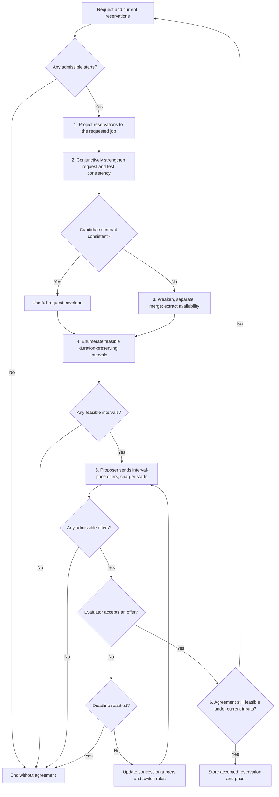
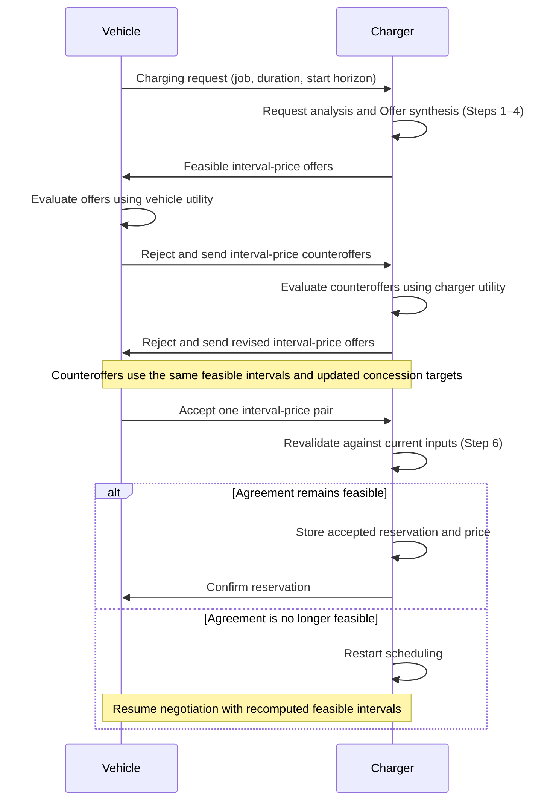

# Contract protocol

The protocol turns a flexible EV charging request into an agreement on one
charging interval and its price. It first checks the request against existing
reservations, repairs the available time region when necessary, and enumerates
feasible intervals of the requested duration. The EV and charger then bargain
over these alternatives. Only an accepted agreement updates the reservations.

The economic stage adapts the alternating-offer mechanism of
[Khan et al. (2020), *Price and Time-Slot Negotiation Protocol for EVs Charging
in Highly Congested Distribution Networks*](https://digibuo.uniovi.es/dspace/handle/10651/58047).
Here, **alternating offers** means that the charger proposes a set of
interval-price pairs, the EV evaluates them using its own utility, and a
rejection switches the proposer and evaluator roles. Each party concedes
toward its minimum acceptable utility as the deadline approaches. Negotiation
ends in acceptance or without agreement. We use the charger as the negotiating
counterpart to the EV; Khan et al. use an aggregator.

The scheduling stage uses separation and merging, following the repair
approach of [Mallozzi et al., *Contract-Based Specification Refinement and
Repair for Mission Planning*](https://arxiv.org/abs/2211.11908).
Our reservation representation, conjunctive strengthening, and
duration-preserving offer generation specify how that approach is used here. Bargaining selects
among the resulting feasible intervals; price rejection leaves this set fixed.

The message exchange below illustrates agreement after one counteroffer from
each party. Either party may accept a received offer earlier; further
rejections repeat the exchange until acceptance or termination. The flowchart
above includes the cases where no feasible interval or admissible offer exists.

## Inputs and notation

Consider one charging point with signal $\textit{job}:X\to\mathbb N_0$;
$0$ denotes an unallocated point. EV $i$ requests a new job $k>0$, duration
$d>0$, and integer start horizon $h\in\mathbb N_0$. Existing reservations are consistent and
belong to other job IDs. The scheduling model permits allocation wherever
no reservation blocks it; additional physical constraints require the
trajectory feasibility check described below.

Use the temporal syntax and satisfaction relation of [LOGIC.md](LOGIC.md):
$\lozenge_\rho$ for eventually, $\square_\rho$ for always, and $d$ for the
relative window $[0,d)$. Charging throughout a duration is a condition
$\square_d\varphi$. Evaluate all contracts at anchor $0$, with represented
time $\mathbb I$ containing $0$, the full request envelope, and all reservation
intervals.

The start-grid policy is, for example,

$$
\begin{aligned}
I&:=\{1,2,\ldots,h\},\\
J_s&:=[s,s+d),\qquad s\in I,\; d = 1.
\end{aligned}
$$

The request envelope is the
Minkowski sum $I\oplus[0,d)=\bigcup_{s\in I}J_s$.

The Minkowski sum $I\oplus[0,d)$, or the available set $J$ introduced later,
may consist of several disjoint intervals. Write any such finite set as
$S=\bigcup_{\ell=1}^m S_\ell$, where $m$ is the number of interval components
and $S_\ell$ is component $\ell$. For example, if $S$ is connected, then $m=1$. Because
LOGIC.md allows only a single interval as a temporal parameter, in the case $m>1$, we consider

$$
\lozenge_S\varphi:=\bigvee_{\ell=1}^m\lozenge_{S_\ell}\varphi,
\qquad
\square_S\varphi:=\bigwedge_{\ell=1}^m\square_{S_\ell}\varphi,
$$

to maintain the correct semantics. As such, $\lozenge_S\varphi$ means that $\varphi$ holds in at least one component
of $S$, whereas $\square_S\varphi$ means that it holds throughout every
component. Each $S_\ell$ is an absolute interval; a permitted start time $s$
is represented by the singleton interval $[s,s]$. Empty unions give $\bot$
and $\top$, respectively.

Write $C=\langle A\mid G\rangle$ for an assume-guarantee contract,
$\bullet$ for contract merging, and $\div$ for separation. These operate
on contracts whose formulas use LOGIC.md. For unconditional contracts,
merging conjoins guarantees. Consistency of $\langle\top\mid G\rangle$
means that some admissible trajectory satisfies $(\xi,0)\models G$.

Requests are assumed to have the form

$$
\boxed{
C^{\mathrm{req}}
:=\left\langle\top\;\middle|\;
\lozenge_I\square_d(\textit{job}=k)\right\rangle.
}
$$

If $I=\varnothing$, the request is trivially infeasible and negotiations can be terminated without agreement.

**Note.** The request contract could be redefined under the interpretation "Find a request contract 'charge for $d$ duration' within $I$ interval." Under that interpretation, one could imagine new syntax and semantics for contracts, such as $\exists_I\left\langle\top\;\middle|\;\square_d(\textit{job}=k)\right\rangle.$
## 1. Project stored reservations to the requested job

**Storage design.** Store each accepted allocation as its concrete job ID
and half-open interval. For reservation record, retain

$$
C^{\mathrm{cmt}}:=\langle\top\mid K\rangle,
\qquad
K:=\bigwedge_{\ell=1}^m\square_{R_\ell}(\textit{job}=k_\ell),
$$

where $R_\ell$ is the reserved interval for commitment $\ell$ with job id $k_\ell$. This representation is chosen so that a later request can project the
reservations to unavailability. Let $p$ be the projected proposition meaning
that the point is allocated to the current job $k$. On the positive allocation
atoms used in stored reservations and requests, define the syntactic operation

$$
\pi_k(\textit{job}=n):=
\begin{cases}
p,&n=k,\\
\neg p,&n\neq k.
\end{cases}
$$

Apply this replacement inside their temporal conditions and Boolean
combinations s.t. $K \overset{\pi_k}{\leadsto}\bar{K}$. Since $k$ is new, every stored reservation projects to
$\square_{R_\ell}\neg p$. Thus

$$
\boxed{
\bar C^{\mathrm{cmt}}:=\langle\top\mid\bar K\rangle,
\qquad
\bar K=\square_R\neg p,
\qquad
R=\bigcup_{\ell=1}^m R_\ell.
}
$$

Projection forgets which other job occupies the point. It is a
reservation-specific abstraction, not an equivalence between
$(\textit{job}=n)$ and $(\textit{job}\neq k)$ in the full signal language.
Keep the original records for final feasibility checks and commitment updates.

## 2. Conjunctively strengthen the request and test contract consistency

**Original requirement: choose one start.** The projected request is

$$
\bar C^{\mathrm{req}}
:=\langle\top\mid\bar G^{\mathrm{req}}\rangle,
\qquad
\bar G^{\mathrm{req}}:=\lozenge_I\square_d p.
$$

The outer condition chooses a start $s$; the inner condition is re-anchored
at $s$ and requires $p$ throughout $[s,s+d)$.

**Conjunctive strengthening.** Replace the existential start condition
$\lozenge_I$ by the universal condition $\square_I$, leaving each duration
window unchanged. The result is the weakest formula that implies every
individual candidate-window requirement:

$$
\begin{aligned}
\bar G^s
&:=\square_I\square_d p\\
&\equiv\square_{I\oplus[0,d)}p,\\
\bar C^s
&:=\langle\top\mid\bar G^s\rangle.
\end{aligned}
$$

For nonempty $I$,
$\bar G^s\Rightarrow\bar G^{\mathrm{req}}$.
The reverse implication does not hold: the strengthened guarantee requires one
trajectory covering the whole envelope, while the request needs only one full
window.
This deliberate strengthening exposes conflicts anywhere in the envelope;
it is temporary and is never stored as a reservation.

Merge with the projected commitments and test:

$$
\begin{aligned}
\bar C^{\mathrm{cand}}
&:=\bar C^{\mathrm{cmt}}\bullet\bar C^s
\;=\langle\top\mid\bar K\land\bar G^s\rangle\\
&=\langle\top\mid\square_R\neg p\land
\square_{I\oplus[0,d)}p\rangle,\\
\bar C^{\mathrm{cand}}\text{ consistent}
&\quad\Longleftrightarrow\quad (I\oplus[0,d))\cap R=\varnothing.
\end{aligned}
$$

- **Success:** set $J:=I\oplus[0,d)$ and proceed to Step 4.
- **Failure:** proceed to Step 3 to remove blocked portions of the envelope.
  This does not yet establish that the original request is infeasible.

For example, with $h=4$, $d=1$, and $R=[1.5,3)$, the request envelope is
$I\oplus[0,d)=[1,5)$.
The candidate contract is inconsistent because of the conflict on $[1.5,3)$,
although the original request can still use $J_3=[3,4)$.

The intersection criterion is exact for the reservation model above. With
additional dynamics or resource constraints, use satisfiability over
admissible trajectories; disjointness alone only rules out reservation conflicts.

## 3. Repair availability

Weaken the strengthened guarantee from continuous coverage to the existence of
an available time:

$$
\bar C^w:=\langle\top\mid\lozenge_{I\oplus[0,d)}p\rangle.
$$

For nonempty $I$ and $d>0$, writing $\preceq$ for refinement, the guarantee
implications and corresponding contract-refinement chain are

$$
\square_I\square_d p
\;\Rightarrow\;
\lozenge_I\square_d p
\;\Rightarrow\;
\lozenge_{I\oplus[0,d)}p,
\qquad
\bar C^s
\preceq\bar C^{\mathrm{req}}
\preceq\bar C^w.
$$

Use this availability abstraction in separation, then merge the result with
the projected commitment:

$$
\bar C^{sp}:=\bar C^w\div\bar C^{\mathrm{cmt}},
\qquad
\bar C^{ms}:=\bar C^{sp}\bullet\bar C^{\mathrm{cmt}}.
$$

The standard definition of separation makes $\bar C^{sp}$ the least separating
contract in the refinement preorder such that

$$
\bar C^w
\preceq\bar C^{\mathrm{cmt}}\bullet\bar C^{sp}
=\bar C^{ms}.
$$

Thus $\bar C^{ms}$ is the separation--merge repair: an abstraction of
$\bar C^w$ that retains the weakened availability goal under the assumptions
needed to coexist with the projected commitments.

For $\bar C^{ms}=\langle\bar A^{ms}\mid\bar G^{ms}\rangle$, make its
assumption an explicit requirement in the scheduling query:

$$
\bar C^{\mathrm{post}}
:=\langle\top\mid\bar A^{ms}\land\bar G^{ms}\rangle
=\langle\top\mid\bar K\land\lozenge_{I\oplus[0,d)}p\rangle.
$$

The last equality is the specialization of the separation/merging algebra to
these unconditional inputs. Simplify the remaining guarantee using

$$
\square_R\neg p\land\lozenge_{I\oplus[0,d)}p
\equiv\square_R\neg p\land
\lozenge_{(I\oplus[0,d))\setminus R}p.
$$

Extract the availability used for offer generation:

$$
\boxed{
J:=(I\oplus[0,d))\setminus R,
\qquad
\bar C^{\mathrm{avail}}:=\langle\top\mid\lozenge_Jp\rangle.
}
$$

Extraction keeps the commitment separately; it does not assert that
$\bar C^{\mathrm{post}}$ and $\bar C^{\mathrm{avail}}$ are equivalent. The relaxed
condition only identifies potential charging times. Step 4 restores the
full duration and start-grid requirements. In the example, $J=[1,1.5)\cup[3,5)$.

## 4. Concretize feasible intervals

For a concrete interval $J'$, use the original job vocabulary:

$$
C_i^{J'}:=\left\langle\top\mid\square_{J'}(\textit{job}=k)\right\rangle.
$$

For either outcome of the consistency test, enumerate

$$
\boxed{
\mathcal J:=\left\{
J_s=[s,s+d):s\in I,\quad J_s\subseteq J,\quad
C^{\mathrm{cmt}}\bullet C_i^{J_s}\text{ consistent}
\right\}.
}
$$

In the reservation model, containment in $J$ supplies the consistency check.
With additional constraints, check each candidate against the original
commitments and the system's admissible trajectories. Every retained contract
refines $C^{\mathrm{req}}$: it chooses an allowed start and preserves $d$.

A nonempty $J$ can still yield $\mathcal J=\varnothing$ if no full window
fits. In the running example, only starts $s\in\{3,4\}$ survive;
the component $[1,1.5)$ is too short. Terminate if $\mathcal J=\varnothing$;
otherwise pass these alternative contracts to bargaining.

## 5. Negotiate interval-price pairs

Keep $\mathcal J$ fixed during bargaining. Use $q$ for the total price,
$r\in\{0,\ldots,T\}$ for the negotiation round, and $T>0$ for the round
deadline. Price is stored as agreement metadata. The following monetary
utilities are a minimal design choice for this adaptation:

$$
u_i^{\mathrm{EV}}(J',q)=v_i(J')-q,
\qquad
u^{\mathrm{CH}}(J',q)=q-c(J'),
$$

where $v_i$ is the EV's value and $c$ the charger's cost. Each party
$a\in\{\mathrm{EV},\mathrm{CH}\}$ maintains a target
$u^a_{\mathrm{exp},r}$ and a minimum acceptable utility $u^a_{\min}$.

**Propose.** The charger starts. The proposer sends a nonempty burst of
alternatives from $\mathcal J$, with prices targeting its expected utility:

$$
\mathcal O_r\subseteq
\left\{(C_i^{J'},q_r(J')):J'\in\mathcal J\right\},
\qquad
u^{\mathrm{prop}}(J',q_r(J'))\approx u^{\mathrm{prop}}_{\mathrm{exp},r}.
$$

Thus the charger targets $q_r(J')\approx c(J')+u^{\mathrm{CH}}_{\mathrm{exp},r}$,
and the EV targets $q_r(J')\approx v_i(J')-u^{\mathrm{EV}}_{\mathrm{exp},r}$.
Every offer must meet the proposer's utility floor. If no admissible offer
can be generated, terminate without agreement.

**Evaluate.** The other party selects its highest-utility proposal:

$$
(J_r^*,q_r^*)\in
\operatorname*{arg\,max}_{(J',q):(C_i^{J'},q)\in\mathcal O_r}
u^{\mathrm{eval}}(J',q).
$$

Before the deadline, accept when this utility meets both the evaluator's
current target and its minimum. At the deadline, accept if it exceeds the
minimum; otherwise terminate. These thresholds are the stopping policy used
in this draft.

**Concede and counteroffer.** After rejection at $r<T$, update each party's
target using the concession rule, with exponent $\lambda_a>0$:

$$
u^a_{\mathrm{exp},r+1}
=u^a_{\mathrm{exp},r}
-u^a_{\mathrm{exp},r}\left(\frac{r}{T}\right)^{\lambda_a}.
$$

Switch roles and advance to round $r+1$. Utility floors continue to apply
even if targets fall below them. Counteroffers may change both interval and
price within $\mathcal J$. If the request or commitments change, recompute
feasibility before continuing negotiation.

## 6. Validate and store the accepted agreement

For an accepted pair $(J^*,q^*)$, revalidate feasibility under current inputs
and store the reservation in the form required by Step 1:

$$
\begin{aligned}
C_i^{\mathrm{acc}}
&:=C_i^{J^*}
=\left\langle\top\mid\square_{J^*}(\textit{job}=k)\right\rangle,\\
\mathcal R&\leftarrow\mathcal R\cup\{(k,J^*)\},\\
C^{\mathrm{cmt}}&\leftarrow C^{\mathrm{cmt}}\bullet C_i^{\mathrm{acc}}.
\end{aligned}
$$

Perform validation and insertion against the same reservation state; if the
agreement is no longer feasible, restart scheduling. Store $q^*$ alongside
the accepted record. For a later request with a different job ID, this record
projects to $\square_{J^*}\neg p$ and contributes $J^*$ to its unavailable set.
The conjunctively strengthened contract, repaired availability, and unaccepted
offers remain temporary.

## Full minimal example

Consider one charger with job $1$ already reserved on $[1.5,3)$. An EV
requests job $2$, duration $d=1$, and start horizon $h=4$, so
$I=\{1,2,3,4\}$. All intervals are half-open: a new reservation may start
exactly when an existing one ends. Assume the reservation model, with no
additional trajectory constraints, and unchanged inputs during this run.

### 1. Project the reservation

The stored commitment and the new request are

$$
\begin{aligned}
C^{\mathrm{cmt}}
&=\langle\top\mid\square_{[1.5,3)}(\textit{job}=1)\rangle,\\
C^{\mathrm{req}}
&=\langle\top\mid\lozenge_{\{1,2,3,4\}}\square_{[0,1)}
(\textit{job}=2)\rangle.
\end{aligned}
$$

Let $p$ mean allocation to job $2$. Projection gives
$\bar K=\square_{[1.5,3)}\neg p$ and
$\bar G^{\mathrm{req}}=\lozenge_{\{1,2,3,4\}}\square_{[0,1)}p$.
The original job record is retained for final validation and storage.

### 2. Strengthen and test consistency

The request needs one full charging window. Temporarily requiring every
candidate window gives

$$
\bar G^s=\square_{\{1,2,3,4\}}\square_{[0,1)}p
\equiv\square_{[1,5)}p.
$$

The merged candidate has guarantee
$\square_{[1.5,3)}\neg p\land\square_{[1,5)}p$ and is inconsistent:
it requires both $p$ and $\neg p$ on $[1.5,3)$. Repair is necessary,
but the original request may still be feasible.

### 3. Repair availability

Weaken to $\bar C^w=\langle\top\mid\lozenge_{[1,5)}p\rangle$,
then separate and merge:

$$
\bar C^{sp}=\bar C^w\div\bar C^{\mathrm{cmt}},
\qquad
\bar C^{ms}=\bar C^{sp}\bullet\bar C^{\mathrm{cmt}}.
$$

Making the repaired contract's assumption an explicit scheduling requirement
produces

$$
\begin{aligned}
\bar C^{\mathrm{post}}
&=\langle\top\mid
\square_{[1.5,3)}\neg p\land\lozenge_{[1,5)}p\rangle,\\
J&=[1,5)\setminus[1.5,3)=[1,1.5)\cup[3,5).
\end{aligned}
$$

The extracted availability condition is $\lozenge_Jp$, with commitments
kept separately. It identifies possible charging times without yet requiring
a full duration.

### 4. Enumerate full-duration alternatives

Check each allowed start against $J$ and the original commitment:

| Start $s$ | Window $J_s$ | Result |
| --- | --- | --- |
| 1 | $[1,2)$ | Reject: overlaps the reservation. |
| 2 | $[2,3)$ | Reject: overlaps the reservation. |
| 3 | $[3,4)$ | Feasible. |
| 4 | $[4,5)$ | Feasible. |

Thus $\mathcal J=\{J_3=[3,4),J_4=[4,5)\}$. The short available component
$[1,1.5)$ cannot accommodate a full window. Each surviving alternative has
contract $C_i^{J_s}=\langle\top\mid\square_{J_s}(\textit{job}=2)\rangle$,
which satisfies the original duration and start requirements.

### 5. Choose economic inputs and negotiate

Use hours for time and one common monetary unit for prices, costs, and
utilities. Assume each alternative purchases $10$ kWh and provides the same
useful charging service. The following inputs are illustrative, not measured
tariffs or preferences.

**Charger perspective.** Use electricity cost alone:
$c(J)=E\pi_J$, with $E=10$ kWh and tariffs $\pi_{J_3}=0.20$ and
$\pi_{J_4}=0.30$ per kWh. Additional demand charges, session costs, and
opportunity costs are set to zero for this example. Hence
$c(J_3)=2$ and $c(J_4)=3$.

**EV perspective.** Suppose obtaining equivalent charging elsewhere has total
cost $C_i^{\mathrm{alternative}}=8$, including travel and inconvenience.
Using this charger has non-price inconvenience $D_i(J_3)=0$ or $D_i(J_4)=1$,
reflecting a preference for the earlier interval. Set

$$
v_i(J)=C_i^{\mathrm{alternative}}-D_i(J),
\qquad
u_i^{\mathrm{EV}}(J,q)=v_i(J)-q.
$$

EV utility now measures savings relative to the alternative. Charger utility
is $u^{\mathrm{CH}}(J,q)=q-c(J)$.

| Economic input | $J_3=[3,4)$ | $J_4=[4,5)$ |
| --- | --- | --- |
| Charger cost $c(J)$ | 2 | 3 |
| EV alternative total cost | 8 | 8 |
| EV inconvenience $D_i(J)$ | 0 | 1 |
| EV value $v_i(J)$ | 8 | 7 |

Set both utility floors to $1$: the charger requires a margin of at least
$1$, and the EV requires savings of at least $1$. Prices meeting both floors
must satisfy

$$
c(J)+u_{\min}^{\mathrm{CH}}\le q
\le v_i(J)-u_{\min}^{\mathrm{EV}}.
$$

These ranges are $[3,7]$ for $J_3$ and $[4,6]$ for $J_4$. Before the
deadline, acceptance also requires the evaluator's current target; at the
deadline, this protocol requires utility strictly above the evaluator's floor.
The ranges are an explanatory calculation, not information the agents must
share: each agent generates and evaluates offers using its own inputs.

Choose initial targets $u_{\mathrm{exp},0}^{\mathrm{EV}}=6$ and
$u_{\mathrm{exp},0}^{\mathrm{CH}}=4$, deadline $T=2$, and
$\lambda_{\mathrm{EV}}=\lambda_{\mathrm{CH}}=1$. These targets are bargaining
ambitions, distinct from costs, values, and floors. Keep $\mathcal J$ fixed.
In the table, $(J,q)$ abbreviates the offer $(C_i^J,q)$.

| Round $r$ | Targets (EV, charger) | Proposer and offers | Evaluator's decision |
| --- | --- | --- | --- |
| 0 | $(6,4)$ | Charger: $(J_3,6)$, $(J_4,7)$ | EV utilities are $2,0$. Best is below target $6$: reject. |
| 1 | $(6,4)$ | EV: $(J_3,2)$, $(J_4,1)$ | Charger utilities are $0,-2$. Best is below target $4$ and floor $1$: reject. |
| 2 | $(3,2)$ | Charger: $(J_3,4)$, $(J_4,5)$ | EV utilities are $4,2$. Choose $(J_3,4)$; utility $4>1$ at the deadline: accept. |

The concession rule specializes to
$u_{\mathrm{exp},r+1}^a=u_{\mathrm{exp},r}^a(1-r/2)$.
After the round-$0$ rejection, targets remain unchanged because $r/T=0$.
After the round-$1$ rejection, both halve. Each rejection also switches the
proposer. All offers meet their proposer's floor, even when they fail the
evaluator's threshold. Costs and values stay fixed throughout these rounds.

### 6. Revalidate and store

The accepted pair is $(J^*,q^*)=([3,4),4)$. Recheck that its start and
duration still satisfy the request and that its interval remains compatible
with current commitments. Validate and insert against the same reservation
state. Since the inputs have not changed, store

$$
\begin{aligned}
\mathcal R&=\{(1,[1.5,3)),(2,[3,4))\},\\
C^{\mathrm{cmt}}
&=\langle\top\mid
\square_{[1.5,3)}(\textit{job}=1)
\land\square_{[3,4)}(\textit{job}=2)\rangle.
\end{aligned}
$$

Attach total price $4$ to the job-$2$ record and confirm the reservation.
The EV obtains utility $8-4=4$ and the charger obtains utility $4-2=2$.
For a later new job, both reservations project to unavailability, whose
union is $[1.5,4)$. The strengthened envelope, repaired availability, and
unaccepted offers remain temporary.

**Other outcomes.** If the strengthened candidate is consistent, use the full
envelope as $J$ and skip repair. Empty allowed starts, no feasible full
windows, no admissible offers, or rejection at the deadline end without
agreement and leave reservations unchanged. Changed requests or commitments
require recomputing feasibility; failed final validation restarts scheduling
before any accepted reservation is inserted.
