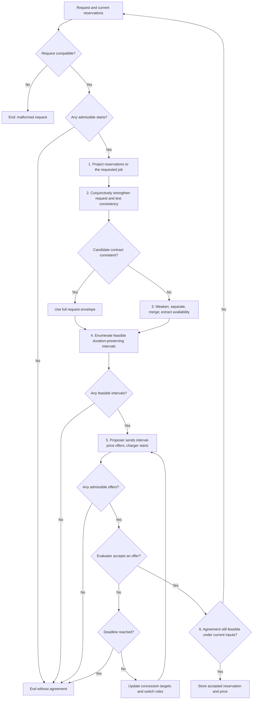
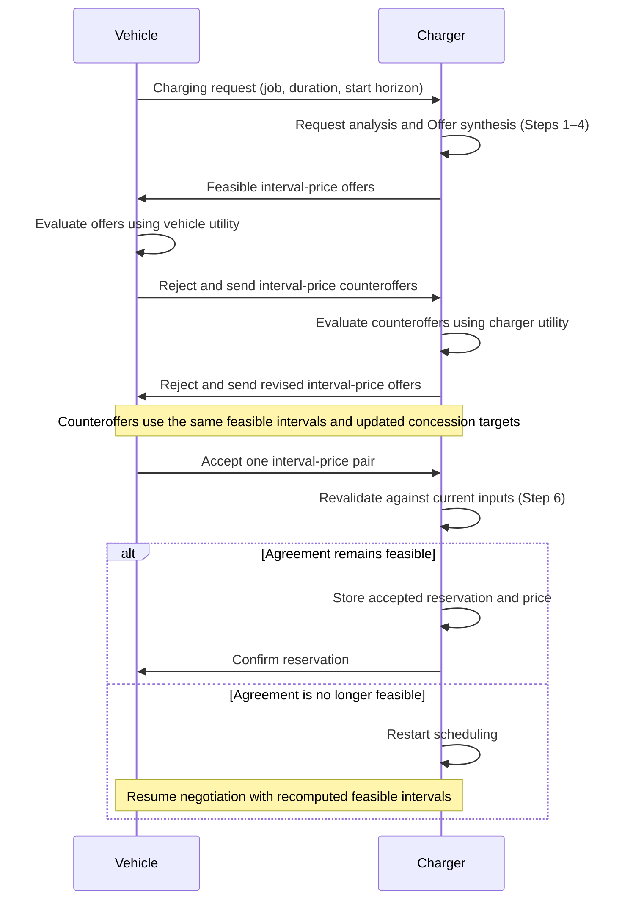

# Contract protocol

The protocol turns a flexible EV charging request into an agreement on one
charging interval and its price. It first checks the request against existing
reservations, repairs the available time region when necessary, and enumerates
feasible intervals of the requested duration. The EV and charger then bargain
over these alternatives. Only an accepted agreement updates the reservations.

The economic stage adapts the alternating-offer mechanism of
[Khan et al. (2020), *Price and Time-Slot Negotiation Protocol for EVs Charging
in Highly Congested Distribution Networks*](https://digibuo.uniovi.es/dspace/handle/10651/58047).
Here, **alternating offers** means that the charger proposes a set of
interval-price pairs, the EV evaluates them using its own utility, and a
rejection switches the proposer and evaluator roles. Each party concedes
toward its minimum acceptable utility as the deadline approaches. Negotiation
ends in acceptance or without agreement. We use the charger as the negotiating
counterpart to the EV; Khan et al. use an aggregator.

The scheduling stage uses separation and merging, following the repair
approach of [Mallozzi et al., *Contract-Based Specification Refinement and
Repair for Mission Planning*](https://arxiv.org/abs/2211.11908).
Our reservation representation, conjunctive strengthening, and
duration-preserving offer generation specify how that approach is used here. Bargaining selects
among the resulting feasible intervals; price rejection leaves this set fixed.



The message exchange below illustrates agreement after one counteroffer from
each party. Either party may accept a received offer earlier; further
rejections repeat the exchange until acceptance or termination. The flowchart
above includes the cases where no feasible interval or admissible offer exists.



## Inputs and notation

**One connector.** This document models a station with a **single connector**:
one physical point at which one vehicle at a time can be plugged in and served.
That is the reading the rest of the document already assumes — a single
commitment set $K$ whose job values are mutually exclusive admits no
overlapping reservations at all — but it is stated here because both signals
below depend on it. A multi-connector station indexes presence per connector,
$\textit{plugged}_c$, so that mutual exclusion holds per connector rather than
per station; $\textit{job}$ then either stays station-wide or splits with it,
and the conflict checks of §4 and §6 become per-connector. Nothing else in the
development changes, but the single-connector reading is load-bearing wherever
mutual exclusion is invoked, and is assumed throughout.

Consider one charging point with signal $\textit{job}:X\to\mathbb N_0$;
$0$ denotes an unallocated point. The point carries a second signal,
$\textit{plugged}$, introduced below. EV $i$ requests a new job $k>0$, duration
$d>0$, and a start set $I$ of admissible start times — generated below by an
integer start horizon $h\in\mathbb N_0$ in the simplest
case. Existing reservations are consistent and
belong to other job IDs. The scheduling model permits allocation wherever
no reservation blocks it; additional physical constraints require the
trajectory feasibility check described below.

Use the temporal syntax and satisfaction relation of [LOGIC.md](LOGIC.md):
$\lozenge_\rho$ for eventually, $\square_\rho$ for always, and $d$ for the
relative window $[0,d)$. Charging throughout a duration is a condition
$\square_d\varphi$. Evaluate all contracts at anchor $0$, with represented time

$$
\boxed{\mathbb I:=[0,\infty).}
$$

Pinning $\mathbb I$ is not bookkeeping. Every temporal parameter denotes
$W_S(a)=S\cap[a,\infty)\cap\mathbb I$
([LOGIC.md](LOGIC.md#temporal-windows)), so a finite or disconnected universe
would truncate regions silently and change which rewrites are valid: with
$\mathbb I$ excluding $[1.5,3)$, the conflicting candidate of §2 becomes
consistent. Taking $\mathbb I=[0,\infty)$ and the anchor $0$ gives $W_S(0)=S$
for every region below, so a region atom denotes exactly its own region. Every
identity in this document is stated under that choice.

**Admissible start sets.** A request's start set $I$ is any **bounded** finite
union of half-open intervals and singletons, $I=\bigcup_{\ell=1}^{m}I_\ell$. A
singleton $[s,s]$ is one discrete start; a continuous component denotes every
start inside it. The integer start grid

$$
I:=\{1,2,\ldots,h\},
\qquad
J_s:=[s,s+d),\qquad s\in I,
$$

is the special case in which every component is a singleton, and is the policy
used by the worked example ($d=1$). Boundedness is required rather than
conventional: §4 must return a finite set of alternatives, and an unbounded
component admits infinitely many pairwise separated starts. Continuous
components are admissible because §4 selects finitely many representatives from
them; nothing before §4 depends on $I$ being finite.

The request envelope is the
Minkowski sum $I\oplus[0,d)=\bigcup_{s\in I}J_s$.


The Minkowski sum $I\oplus[0,d)$, or the available set $J$ introduced later,
may consist of several disjoint intervals. Write any such finite set as
$S=\bigcup_{\ell=1}^m S_\ell$, where $m$ is the number of interval components
and $S_\ell$ is component $\ell$. For example, if $S$ is connected, then $m=1$. Because
LOGIC.md allows only a single interval as a temporal parameter, in the case $m>1$, we consider

$$
\lozenge_S\varphi:=\bigvee_{\ell=1}^m\lozenge_{S_\ell}\varphi,
\qquad
\square_S\varphi:=\bigwedge_{\ell=1}^m\square_{S_\ell}\varphi,
$$

to maintain the correct semantics. As such, $\lozenge_S\varphi$ means that $\varphi$ holds in at least one component
of $S$, whereas $\square_S\varphi$ means that it holds throughout every
component. Each $S_\ell$ is an absolute interval; a permitted start time $s$
is represented by the singleton interval $[s,s]$. Empty unions give $\bot$
and $\top$, respectively.


### Presence: the vehicle's signal

The charging point carries a second signal, controlled by the vehicle rather
than by the charger:

$$
\boxed{
\textit{plugged}:X\to\mathbb N_0,
\qquad
\textit{plugged}(t)=0\ \text{: nothing connected},
\qquad
\textit{plugged}(t)=k\ \text{: vehicle }k\text{ connected}.
}
$$

Keeping presence separate from allocation is the whole point of the pair:
$\textit{job}$ is the charger's decision and $\textit{plugged}$ is the
vehicle's. Neither party controls both. Energy flows only where the two agree,
so define

$$
\boxed{\textit{charging}_k:=(\textit{job}=k)\land(\textit{plugged}=k).}
$$

**Signal, not proposition.** A bare proposition $\textit{plugged}$ cannot say
*which* vehicle is connected, so a charger would owe its guarantee whenever any
car occupied the point — including the wrong one. A signal keeps the identity
and inherits the mutual exclusion the simplifier already enforces on signal
assignments, so $\square_S(\textit{plugged}=2)\land\square_S(\textit{plugged}=3)$
reduces to $\bot$ without a new rule. One proposition per job
($\textit{plugged}_k$) would also work for a fixed finite job set, but it makes
the vocabulary grow with the fleet. The signal is the right choice, and it
costs nothing: LOGIC.md's grammar already admits several signals.

**What presence is for.** Without it every contract in this protocol is
$\langle\top\mid G\rangle$, and the assume-guarantee machinery carries no load —
the one nontrivial assumption that ever appears is the residual $\bar A^{ms}$
of §3, an artifact of separation rather than a statement about anyone's
environment. From the charger's side the environment *is* the vehicle, so a
useful assumption has to be about vehicle behaviour, has to vary over time, and
has to be revisable mid-session so that a violation is a well-defined event.
Presence is the smallest signal with all three properties.

**Commitments become conditional.** An accepted agreement is stored as the
conditional contract it is,

$$
C_i^{\mathrm{acc}}
:=\left\langle\ \square_{J^*}(\textit{plugged}=k)\ \middle|\ \square_{J^*}(\textit{job}=k)\right\rangle,
\qquad
C^{\mathrm{cmt}}\leftarrow C^{\mathrm{cmt}}\bullet C_i^{\mathrm{acc}},
$$

so $C^{\mathrm{cmt}}$ is a merge of conditional contracts and its assumption is
the conjunction of every stored presence window. Because $\textit{plugged}$ is
one signal with mutually exclusive values, that conjunction records a second,
independent conflict condition: two commitments to *different* vehicles over
overlapping windows have $A_1\land A_2\equiv\bot$. This is the first place the
assumption slot does work, and §4 and §6 depend on it.

**Scheduling still sees an unconditional abstraction.** Step 1 projects the
commitments to *unavailability*, and that abstraction is deliberately
unconditional: a stored reservation blocks a later request whether or not its
vehicle turns up, because at scheduling time the charger cannot know who will
arrive, and availability must be decidable from the records alone. So Step 1
keeps only the $\textit{job}$ side,

$$
\bar C^{\mathrm{cmt}}:=\left\langle\top\mid\square_R\neg p\right\rangle,
$$

which is a guarantee-weakening of the stored record — a refinement step in the
direction of abstraction, of the same kind as §3's passage to
$\bar C^{\mathrm{avail}}$. Steps 1–3 are therefore unchanged by presence, and
$\bar C^{\mathrm{cand}}$ in §2 stays unconditional. Conditionality is not lost;
it is simply not what the availability question is about. Steps 4 and 6 work
against the *stored* commitments, in the original vocabulary, where it is
retained.

**Guarantees mention only the charger's signal.** In $C^{\mathrm{acc}}_i$ the
assumption constrains $\textit{plugged}$ and the guarantee constrains
$\textit{job}$, and neither mentions the other party's signal. This is not a
stylistic preference: a component may only promise what it controls. Charging
itself is the conjunction, delivered jointly — under the assumption,
$\square_{J^*}(\textit{plugged}=k)\land\square_{J^*}(\textit{job}=k)\equiv\square_{J^*}\textit{charging}_k$,
so the pair delivers energy without
either side promising the other's behaviour.

### Contracts

Write $C=\langle A\mid G\rangle$ for an assume-guarantee contract, with $A$ and
$G$ formulas of LOGIC.md read at anchor $0$. The contract obliges the component
to deliver $G$ on every trajectory whose environment delivers $A$, and says
nothing when $A$ fails. Write $\bullet$ for merging and $\div$ for separation.

**Saturation.** Two contracts differing only where their assumption fails
impose the same obligation. Every contract here is therefore stored
**saturated**:

$$
\boxed{\langle A\mid G\rangle\ \text{is stored as}\ \langle A\mid G\lor\neg A\rangle.}
$$

Saturation is idempotent and changes no obligation. It is not optional: the
operations below read $G$ directly, so an unsaturated guarantee would let the
comparison of two contracts turn on trajectories neither one constrains. An
unconditional contract $\langle\top\mid G\rangle$ is already saturated, which
is why §1 and §2 never mention saturation.

**Refinement.** $C_1\preceq C_2$ ("$C_1$ refines $C_2$") when $C_1$ accepts at
least as many environments and promises at least as much:

$$
C_1\preceq C_2
\quad:\Longleftrightarrow\quad
A_2\Rightarrow A_1
\quad\text{and}\quad
G_1\Rightarrow G_2 .
$$

**Merging and separation.** For saturated $C_1,C_2$,

$$
\boxed{
\begin{aligned}
C_1\bullet C_2
&:=\left\langle\, A_1\land A_2
\;\middle|\;(G_1\land G_2)\lor\neg(A_1\land A_2)\,\right\rangle,\\[2pt]
C_1\div C_2
&:=\left\langle\,(A_1\land G_2)\lor\neg(G_1\land A_2)
\;\middle|\;G_1\land A_2\,\right\rangle.
\end{aligned}
}
$$

Merging conjoins both slots and re-saturates; on unconditional contracts it
reduces to conjoining guarantees, the only case Steps 1, 2 and 4 need. Step 3
needs the general form, because $\bar C^{sp}$ has a nontrivial assumption.
Separation is the residual that the repair of Mallozzi et al. calls for: it
satisfies the characterization used in §3, $C_1\preceq C_2\bullet(C_1\div C_2)$,
and is the least such contract under $\preceq$. Both results are again
saturated.

**Consistency, compatibility, realizability.** All three are satisfiability
questions over admissible trajectories at anchor $0$:

$$
\begin{aligned}
C\ \text{consistent}
&\quad:\Longleftrightarrow\quad
\exists\ \text{admissible }\xi:\ (\xi,0)\models G,\\
C\ \text{compatible}
&\quad:\Longleftrightarrow\quad
\exists\ \text{admissible }\xi:\ (\xi,0)\models A,\\
C\ \text{realizable}
&\quad:\Longleftrightarrow\quad
\exists\ \text{admissible }\xi:\ (\xi,0)\models A\land G.
\end{aligned}
$$

Consistency asks whether the promise can be kept, compatibility whether the
assumption can be met, and realizability both at once. On an unconditional
contract all three coincide with the original definition, which is the only
case Steps 2 and 4 use. On a conditional contract consistency alone is weak:
the saturated guarantee $G\lor\neg A$ is satisfied vacuously by any trajectory
violating $A$, so a contract with an unsatisfiable assumption is consistent and
useless. Realizability is the query that survives a nontrivial assumption, and
$\bar C^{\mathrm{post}}$ in §3 is exactly the realizability query of
$\bar C^{ms}$ written as an unconditional contract.

These are definitions, not procedures. The next subsection gives the one
procedure that decides them for the formulas this protocol actually builds.

### Requests

Requests are assumed to have the form

$$
\boxed{
C^{\mathrm{req}}
:=\left\langle\top\;\middle|\;
\lozenge_I\square_d(\textit{job}=k)\right\rangle.
}
$$

If $I=\varnothing$, the request is trivially infeasible and negotiations can be terminated without agreement.

**Intake: a malformed request.** The assumption side has a twin of that rule. A
request whose assumption is unsatisfiable is **malformed**: it promises a
presence pattern that no admissible trajectory realizes — for instance the
arrival and departure bounds of §2's strength 3 with
$[t_0,t_1)\cup[t_2,\infty)$ leaving no full $d$-window inside $I$. No allocation
repairs such a request, so it is not a scheduling result at all:

$$
\boxed{
\text{if }\mathrm{sat}(A^{\mathrm{req}})\text{ fails, terminate without agreement and report the defect to the vehicle.}
}
$$

Check this **once, before Step 1**. Compatibility depends only on the request,
never on the commitments, so it cannot change while scheduling proceeds — it is
input validation, not a scheduling outcome, and it deserves a terminal outcome
of its own rather than being reported as "no feasible interval". A request with
a trivial assumption, which is the default of §4, passes this check
automatically.

**Note.** The request contract could be redefined under the interpretation "Find a request contract 'charge for $d$ duration' within $I$ interval." Under that interpretation, one could imagine new syntax and semantics for contracts, such as $\exists_I\left\langle\top\;\middle|\;\square_d(\textit{job}=k)\right\rangle.$

### The reservation fragment and its realization

The introduction commits this protocol to being contract-driven. That commits
it to something checkable: interval arithmetic may appear only **inside the
realization of a contract operation**, never as a second, independently
computed answer that a contract-level statement is afterwards reconciled with.
This subsection states the realization once. Steps 2, 3, 4 and 6 each reach
into the formula layer, and each does so by applying the lemma below rather
than by intersecting intervals on its own authority. (Policy inputs are outside
this rule: the start set and §4's representative rule choose *which* contracts
to build, they do not compute a contract's result.)

**The fragment.** Every formula this protocol builds is a Boolean combination
of **region atoms**

$$
\square_S(\sigma=k),
\qquad
\lozenge_S(\sigma=k),
$$

over a signal $\sigma\in\{\textit{job},\textit{plugged}\}$ and a region
$S\subseteq\mathbb I$ that is a finite union of intervals spelled by the
grouping convention above, together with their projections
$\square_Sp,\ \lozenge_Sp$ and $\square_Sq,\ \lozenge_Sq$ (and the negated
forms). Call this the **reservation fragment**. It is closed under $\land$,
$\lor$ and negation: negation-normal form only exchanges the two operators,
since $\neg\square_S\varphi\equiv\lozenge_S\neg\varphi$.

**Contradiction is per signal.** Two distinct signals may take any pair of
values at any time, so no conjunction mixing them is contradictory on that
account. Within one signal, mutual exclusion applies:

$$
\boxed{
\square_S(\sigma=k)\land\square_{S'}(\sigma=k')\equiv\bot
\quad\Longleftrightarrow\quad
k\neq k'\ \text{ and }\ S\cap S'\neq\varnothing,
}
$$

with no contradiction across distinct signals. The interval arithmetic
underneath is exactly Section A's; only the bookkeeping is now indexed by
signal. Every query below therefore **decomposes by signal**: a conjunction is
satisfiable exactly when its $\textit{job}$ part and its $\textit{plugged}$
part are separately satisfiable. That is what keeps presence from disturbing
Section A's results — and, read the other way, it is what lets the *same*
non-overlap check serve two different questions: on $\textit{job}$, may the
charger allocate; on $\textit{plugged}$, can the vehicles all be there.

**The fragment is read at a fixed anchor.** A region atom denotes
$W_S(0)=S\cap[0,\infty)\cap\mathbb I=S$ *because* the anchor is $0$ and
$\mathbb I=[0,\infty)$. At anchor $a$ the same atom denotes $S\cap[a,\infty)$.
Every identity below — including §2's envelope rewrite — is therefore a
statement about formulas at anchor $0$, not an anchor-free identity. The whole
protocol evaluates at anchor $0$, so this costs nothing; it is stated because
the identities are false without it.

**Normalization.** Put a fragment formula into negation-normal form, spell each
disconnected region as its components, and apply the two region rewrites

$$
\begin{aligned}
\square_I\square_d\varphi
&\;\equiv\;\square_{I\oplus[0,d)}\varphi,\\
\square_R\psi\land\lozenge_E\varphi
&\;\equiv\;\square_R\psi\land\lozenge_{E\setminus R}\varphi
&&\text{when }\varphi\land\psi\text{ is contradictory,}
\end{aligned}
$$

then take the conjunctive normal form closed under resolution, discarding
tautologous and subsumed clauses. The first rewrite needs the anchor; the
second does not, since a witness in $W_E(0)$ avoids $R$ exactly when it avoids
$W_R(0)$. Both preserve local truth, because a temporal condition is globally
valued at its anchor
([CODE.md](CODE.md#parsing-formatting-rewriting-and-traversal)). Resolution is
the step that does real work, and §3 shows it is not bookkeeping.

**Lemma (realization over the reservation fragment).** Fix anchor $0$ and
$\mathbb I=[0,\infty)$, and let $G$ be normalized as above. Then:

1. **Consistency.** $G$ is consistent exactly when its normal form is not
   $\bot$. The fragment admits only two sources of contradiction, and each is
   decided by a region intersection:

   $$
   \square_Sp\land\square_{S'}\neg p\equiv\bot
   \iff S\cap S'\neq\varnothing,
   \qquad
   \lozenge_Sp\land\square_S\neg p\equiv\bot .
   $$

   Soundness is immediate, since normalization preserves equivalence: a normal
   form $\bot$ means $G$ has no model. Exactness — that a surviving normal form
   always has one — rests on the model having no dynamics. The signal may take
   any value at any time, so a trajectory is assembled by choosing one
   satisfied literal per clause, setting $\textit{job}$ to $k$ throughout the
   regions its universal literals demand and at one point inside each
   existential literal's region, and to an unused id elsewhere. Mutual
   exclusion of signal values is the only interaction between literals, which
   is why the two contradictions above are the only ones.
2. **Witness region.** A normal form $\square_R\neg p\land\lozenge_Ep$ permits
   the requested job exactly on $E\setminus R$, which is what the second
   rewrite has already computed. The region is *read off* the normalized
   guarantee, not calculated beside it.
3. **Three queries, one procedure.** Clause 1 decides satisfiability of a
   fragment formula. The contract-level questions of §Inputs are that one
   procedure applied to three different formulas:

   $$
   \text{consistent}(C)=\mathrm{sat}(G),
   \qquad
   \text{compatible}(C)=\mathrm{sat}(A),
   \qquad
   \text{realizable}(C)=\mathrm{sat}(A\land G).
   $$

   Note $\text{realizable}(C)=\text{consistent}(C^{\mathrm{post}})$ for the
   promotion of §3: promotion is the query device, and §3 carries its soundness
   argument. Promotion nonetheless stays a device rather than a rewrite of the
   offer — a contract that *demands* presence is a different commercial object
   from one that assumes it. **Consistency is not a substitute for
   realizability**: the saturated guarantee $G\lor\neg A$ is satisfied by every
   trajectory violating $A$, so a conditional contract is consistent whatever
   its guarantee says, and an *incompatible* one is consistent precisely
   because it is broken. Which site asks which query is settled in §4 and §6.
4. **Containment.** Let $J=E\setminus R$ be the witness region of clause 2 and
   let $J'=[s,s+d)$ with $s\in I$, so that $J'\subseteq E$ holds by
   construction. Then $J'\subseteq J$ reduces to $J'\cap R=\varnothing$, which
   is clause 1 applied to
   $\langle\top\mid\square_R\neg p\land\square_{J'}p\rangle$. Containment is
   therefore not a separate test.

The protocol's four uses of the formula layer are the four applications of this
lemma:

| Site | Query | Contract-level question | Lemma clause |
| --- | --- | --- | --- |
| intake | $\mathrm{sat}(A^{\mathrm{req}})$ | is the request compatible? | 1 |
| §2 | $\mathrm{sat}(\bar G^{\mathrm{cand}})$ | is $\bar C^{\mathrm{cand}}$ consistent? | 1 |
| §3 | witness region of $\bar C^{\mathrm{post}}$ | what does the repair still permit? | 2 |
| §4 | $\mathrm{sat}(A\land G)$ of the merge | is this offer realizable? | 4, then 3 |
| §6 | $\mathrm{sat}(A\land G)$ of the merge | is the agreement still realizable? | 3 |

$\bar C^{\mathrm{cand}}$ is unconditional, so §2 keeps consistency; everything
downstream of an offer is conditional and must ask realizability.

§4 and §6 are callers of the same query as §2, not new checks. An
implementation should share one procedure across all four; where the reference
implementation has separate `consistent`, `availability` and `erode` helpers,
they are three entry points to this lemma and agree by construction rather than
by coincidence.

**Scope.** The lemma is exact for the reservation model and nothing more. It
relies on the fragment having no dynamics: allocation is permitted wherever no
reservation blocks it. Add energy, ramping, or resource coupling and clause 1's
witness construction fails — the surviving clauses no longer describe an
admissible trajectory — so consistency must be decided by satisfiability over
admissible trajectories, the reachability query of
[BACKEND.md](BACKEND.md). The queries in Steps 2, 3, 4 and 6 are stated as
contract-level questions precisely so that such a model changes only this
subsection.


## 1. Project stored reservations to the requested job

**Storage design.** Store each accepted allocation as its concrete job ID
and half-open interval. For reservation record, retain

$$
C^{\mathrm{cmt}}:=\langle\top\mid K\rangle,
\qquad
K:=\bigwedge_{\ell=1}^m\square_{R_\ell}(\textit{job}=k_\ell),
$$

where $R_\ell$ is the reserved interval for commitment $\ell$ with job id $k_\ell$. This representation is chosen so that a later request can project the
reservations to unavailability. Let $p$ mean that the point is allocated to the
current job $k$, and $q$ that vehicle $k$ is connected. Projection is indexed by
the signal it abstracts, and carries the two signals to two **independent**
propositions rather than collapsing both onto $p$:

$$
\boxed{
\pi_k(\textit{job}=n):=
\begin{cases}
p,&n=k,\\
\neg p,&n\neq k,
\end{cases}
\qquad
\pi_k(\textit{plugged}=n):=
\begin{cases}
q,&n=k,\\
\neg q,&n\neq k.
\end{cases}
}
$$

Collapsing them would be a category error, not an imprecision: it would turn
the vehicle's promise to be present into a claim about the charger's own
allocation, and the two-sorted contradiction table of the realization lemma
would then report conflicts that do not exist.

Apply this replacement inside their temporal conditions and Boolean
combinations s.t. $K \overset{\pi_k}{\leadsto}\bar{K}$. Since $k$ is new, every stored reservation projects to
$\square_{R_\ell}\neg p$ on the guarantee side. As §Inputs explains, the
availability abstraction keeps only that side: the presence assumption of the
stored commitments is dropped, because a reservation blocks a later request
whether or not its vehicle arrives. Thus

$$
\boxed{
\bar C^{\mathrm{cmt}}:=\langle\top\mid\bar K\rangle,
\qquad
\bar K=\square_R\neg p,
\qquad
R=\bigcup_{\ell=1}^m R_\ell.
}
$$

Projection forgets which other job occupies the point. It is a
reservation-specific abstraction, not an equivalence between
$(\textit{job}=n)$ and $(\textit{job}\neq k)$ in the full signal language.
Keep the original records for final feasibility checks and commitment updates.

## 2. Conjunctively strengthen the request and test contract consistency

**Original requirement: choose one start.** The projected request is

$$
\bar C^{\mathrm{req}}
:=\langle\top\mid\bar G^{\mathrm{req}}\rangle,
\qquad
\bar G^{\mathrm{req}}:=\lozenge_I\square_d p.
$$

The outer condition chooses a start $s$; the inner condition is re-anchored
at $s$ and requires $p$ throughout $[s,s+d)$.

**Conjunctive strengthening.** Replace the existential start condition
$\lozenge_I$ by the universal condition $\square_I$, leaving each duration
window unchanged. The result is the weakest formula that implies every
individual candidate-window requirement:

$$
\begin{aligned}
\bar G^s
&:=\square_I\square_d p\\
&\equiv\square_{I\oplus[0,d)}p,\\
\bar C^s
&:=\langle\top\mid\bar G^s\rangle.
\end{aligned}
$$

For nonempty $I$,
$\bar G^s\Rightarrow\bar G^{\mathrm{req}}$.
The reverse implication does not hold: the strengthened guarantee requires one
trajectory covering the whole envelope, while the request needs only one full
window.
This deliberate strengthening exposes conflicts anywhere in the envelope;
it is temporary and is never stored as a reservation.

**The envelope rewrite holds at anchor $0$, not in general.** The second line
above is the first region rewrite of the realization lemma, and it is not a
plain identity. The envelope is built from the *window* $W_I(a)=I\cap[a,\infty)\cap\mathbb I$,
so starts before the anchor impose nothing: with $I=\{1,2,3,4\}$ and $d=1$,
reading $\square_I\square_dp$ at anchor $0$ gives $\square_{[1,5)}p$, but at
anchor $3$ it gives $\square_{[3,5)}p$. The protocol reads every contract at
anchor $0$, where $W_I(0)=I$, so $\bar G^s\equiv\square_{I\oplus[0,d)}p$ as
written. Anywhere else the rewrite must be re-derived against the anchor.

Merge with the projected commitments:

$$
\begin{aligned}
\bar C^{\mathrm{cand}}
&:=\bar C^{\mathrm{cmt}}\bullet\bar C^s
\;=\langle\top\mid\bar K\land\bar G^s\rangle\\
&=\langle\top\mid\square_R\neg p\land
\square_{I\oplus[0,d)}p\rangle .
\end{aligned}
$$

**The test is a contract-level query.** What Step 2 asks is the consistency
query of the previous section, and nothing else:

$$
\boxed{
\bar C^{\mathrm{cand}}\ \text{consistent}
\quad:\Longleftrightarrow\quad
\exists\ \text{admissible }\xi:\
(\xi,0)\models\square_R\neg p\land\square_{I\oplus[0,d)}p .
}
$$

This is the definition. The interval test is its *realization*, obtained by
applying clause 1 of the realization lemma: the normalized guarantee is a
conjunction of two universal region literals, whose only available
contradiction is $\square_Sp\land\square_{S'}\neg p$ with $S\cap S'\neq\varnothing$.
Hence

$$
\bar C^{\mathrm{cand}}\ \text{consistent}
\quad\Longleftrightarrow\quad
(I\oplus[0,d))\cap R=\varnothing .
$$

The order matters. Deciding the question by intersecting two intervals needs no
contracts at all, so if the intersection came first the contract machinery would
be narration. It comes second, as one instance of a query that Steps 3, 4 and 6
also raise and that a richer model answers differently — by satisfiability over
admissible trajectories, with disjointness no longer sufficient. The scope note
in the realization lemma governs here.

- **Success:** set $J:=I\oplus[0,d)$ and proceed to Step 4.
- **Failure:** proceed to Step 3 to remove blocked portions of the envelope.
  This does not yet establish that the original request is infeasible.

For example, with $h=4$, $d=1$, and $R=[1.5,3)$, the request envelope is
$I\oplus[0,d)=[1,5)$.
The candidate contract is inconsistent because of the conflict on $[1.5,3)$,
although the original request can still use $J_3=[3,4)$.
### Where strengthening comes from

As presented above, conjunctive strengthening is a proof device: a temporary
over-requirement whose only job is to expose conflicts, discarded in Step 3.
That is the honest reading **when the vehicle commits to a window**. Under a
weaker presence assumption it stops being a device and becomes the charger's
actual obligation.

**A ladder of presence assumptions.** Presence admits several strengths,
weakest commitment last:

| # | Assumption | What the vehicle promises |
| --- | --- | --- |
| 1 | $\square_{J_s}(\textit{plugged}=k)$ | present throughout one agreed window |
| 2 | $\lozenge_I\square_d(\textit{plugged}=k)$ | present for *some* full $d$-window in $I$, unsaid which |
| 3 | $\square_{[t_0,t_1)}(\textit{plugged}\neq k)$, $\square_{[t_2,\infty)}(\textit{plugged}\neq k)$ | arrival and departure bounds only |

Strength 1 is the default used by §4 and the worked example. Strength 2 mirrors
the request itself, and it is the interesting one.

**Under strength 2 the charger must hold the whole envelope.** Take the request
contract at strength 2, with the service guarantee written in terms of
$\textit{charging}_k$ — energy, not allocation:

$$
C^{\mathrm{req}}_2
:=\left\langle\ \lozenge_I\square_d(\textit{plugged}=k)
\ \middle|\ \lozenge_I\square_d\,\textit{charging}_k\ \right\rangle .
$$

**Proposition.** Any allocation satisfying $C^{\mathrm{req}}_2$ without
observing $\textit{plugged}$ satisfies $\square_{I\oplus[0,d)}(\textit{job}=k)$,
which is exactly $\bar G^s$.

*Proof.* Suppose $\textit{job}(t)\neq k$ for some $t\in I\oplus[0,d)$. Then
$t\in J_{s'}$ for some $s'\in I$. Consider the trajectory whose presence is
exactly $J_{s'}$: it satisfies the assumption. Charging can hold only where
presence does, so $\textit{charging}_k\subseteq J_{s'}$, and the only candidate
window contained in $J_{s'}$ is $J_{s'}$ itself. But $t\in J_{s'}$ has
$\textit{job}(t)\neq k$, so $\square_d\textit{charging}_k$ fails at $s'$ too,
and the guarantee fails on a trajectory satisfying the assumption. Hence no
such $t$ exists. $\square$

So the strengthening that §2 introduces as a temporary device is, under an
existential presence assumption, the weakest allocation the charger can
actually commit to. The vehicle refused to say which window it would use, and
covering every candidate is the charger's honest response. Conjunctive
strengthening becomes part of the model rather than a step in a proof.

**Two caveats, stated plainly.** The proposition assumes the charger does *not*
observe $\textit{plugged}$ and react — a contract here is a constraint on
trajectories, not a strategy. A charger that can watch the point and allocate
reactively does better, and specifying that needs a notion of strategy this
document does not have. Second, the proposition is about what must be
*allocated*, not what must be *paid for*: the charger holds
$|I\oplus[0,d)|$ of time and sells $d$ of energy, so strength 2 is only
economic if the flexibility is priced. That is the concrete sense in which the
assumption slot becomes negotiable — see §5.


## 3. Repair availability

Weaken the strengthened guarantee from continuous coverage to the existence of
an available time:

$$
\bar C^w:=\langle\top\mid\lozenge_{I\oplus[0,d)}p\rangle.
$$

For nonempty $I$ and $d>0$, writing $\preceq$ for refinement, the guarantee
implications and corresponding contract-refinement chain are

$$
\square_I\square_d p
\;\Rightarrow\;
\lozenge_I\square_d p
\;\Rightarrow\;
\lozenge_{I\oplus[0,d)}p,
\qquad
\bar C^s
\preceq\bar C^{\mathrm{req}}
\preceq\bar C^w.
$$

Use this availability abstraction in separation, then merge the result with
the projected commitment:

$$
\bar C^{sp}:=\bar C^w\div\bar C^{\mathrm{cmt}},
\qquad
\bar C^{ms}:=\bar C^{sp}\bullet\bar C^{\mathrm{cmt}}.
$$

The definition of $\div$ in §Inputs makes $\bar C^{sp}$ the least separating
contract in the refinement preorder such that

$$
\bar C^w
\preceq\bar C^{\mathrm{cmt}}\bullet\bar C^{sp}
=\bar C^{ms}.
$$

Thus $\bar C^{ms}$ is the separation--merge repair: an abstraction of
$\bar C^w$ that retains the weakened availability goal under the assumptions
needed to coexist with the projected commitments.

**Computing the repair.** Write $E:=I\oplus[0,d)$. Both inputs are
unconditional, so the definitions of $\div$ and $\bullet$ give

$$
\begin{aligned}
\bar C^{sp}
&=\bar C^w\div\bar C^{\mathrm{cmt}}
=\left\langle\ \bar K\lor\neg\lozenge_Ep\ \middle|\ \lozenge_Ep\ \right\rangle
=\left\langle\ \bar K\lor\square_E\neg p\ \middle|\ \lozenge_Ep\ \right\rangle,\\[2pt]
\bar A^{ms}&=\bar K\lor\square_E\neg p,\\[2pt]
\bar G^{ms}&=(\lozenge_Ep\land\bar K)\lor\neg\bar A^{ms}
=(\lozenge_Ep\land\bar K)\lor(\lozenge_Ep\land\lozenge_Rp).
\end{aligned}
$$

This is the one place in the protocol where a nontrivial assumption appears,
and it is an artifact of separation rather than a statement about anyone's
environment. That is why the next step can discharge it outright.

**Promoting the assumption.** For
$\bar C^{ms}=\langle\bar A^{ms}\mid\bar G^{ms}\rangle$, make its assumption an
explicit requirement in the scheduling query:

$$
\bar C^{\mathrm{post}}
:=\langle\top\mid\bar A^{ms}\land\bar G^{ms}\rangle .
$$

This is a choice, and it is sound for a stated reason. Promotion is exactly the
realizability query of $\bar C^{ms}$ written as an unconditional contract, and
the promoted contract refines the conditional one,

$$
\langle\top\mid A\land G\rangle
\ \preceq\
\langle A\mid G\lor\neg A\rangle,
$$

since $A\Rightarrow\top$ and $A\land G\Rightarrow G\lor\neg A$. So anything
implementing $\bar C^{\mathrm{post}}$ implements $\bar C^{ms}$, and the
scheduling query is never weakened by the step. What the charger gives up is
the right to discharge its obligation by blaming the environment: $\bar A^{ms}$
is a residual produced by separation, not a promise the vehicle made, so the
charger has no grounds to assume it and instead undertakes to establish it. The
cost is that promotion can turn an unrealizable repair into an inconsistent
contract — which is the correct outcome, since the guarantee could not have
been met anyway. Should the vehicle ever supply a genuine assumption, promotion
would no longer be the right move and $\bar A^{ms}$ would be discharged against
that assumption instead.

**The equality is Boolean resolution, not region simplification.** Substituting
the two displays above,

$$
\bar C^{\mathrm{post}}
=\left\langle\top\ \middle|\
\bigl(\bar K\lor\square_E\neg p\bigr)\land
\bigl((\lozenge_Ep\land\bar K)\lor(\lozenge_Ep\land\lozenge_Rp)\bigr)\right\rangle .
$$

Reaching the boxed form takes resolution *across* the two factors. Distribute,
and use $\lozenge_Sp\land\square_S\neg p\equiv\bot$ twice — once at $S=E$, once
at $S=R$, where $\lozenge_Rp=\neg\bar K$. The second disjunct dies against both
branches of the first factor: against $\bar K=\square_R\neg p$ through its
$\lozenge_Rp$ literal, and against $\square_E\neg p$ through its $\lozenge_Ep$
literal. In the surviving disjunct the $\square_E\neg p$ branch dies the same
way, leaving the $\bar K$ branch, which that disjunct already carries:

$$
\bar C^{\mathrm{post}}
=\langle\top\mid\bar K\land\lozenge_{I\oplus[0,d)}p\rangle .
$$

The equality holds, but it is not a specialization that can be read off: it is
clause-level resolution, the step the realization lemma warns is real work. Only
afterwards does the region rewrite apply:

$$
\square_R\neg p\land\lozenge_{I\oplus[0,d)}p
\equiv\square_R\neg p\land
\lozenge_{(I\oplus[0,d))\setminus R}p.
$$

Extract the availability used for offer generation:

$$
\boxed{
J:=(I\oplus[0,d))\setminus R,
\qquad
\bar C^{\mathrm{avail}}:=\langle\top\mid\lozenge_Jp\rangle.
}
$$

**$J$ is read off, not computed beside.** The rewrite above is the second
region rewrite of the realization lemma, and the boxed $J$ is clause 2 applied
to the normalized $\bar C^{\mathrm{post}}$: the witness region a normalized
$\square_R\neg p\land\lozenge_Ep$ still permits is $E\setminus R$, already
present as the parameter of the surviving existential literal. No interval
difference is taken outside the rewrite.

Passing from $\bar C^{\mathrm{post}}$ to $\bar C^{\mathrm{avail}}$ drops the
conjunct $\bar K$. That is a guarantee weakening, so it is a refinement step in
the direction of abstraction — $\bar C^{\mathrm{post}}\preceq\bar C^{\mathrm{avail}}$ —
and not an equivalence. It is sound because the commitment is kept separately
and re-imposed in Step 4; $\bar C^{\mathrm{avail}}$ alone only identifies
potential charging times, and Step 4 restores the full duration and start-set
requirements. In the example, $J=[1,1.5)\cup[3,5)$.

## 4. Concretize feasible intervals

For a concrete interval $J'$, use the original job vocabulary, and make the
offer conditional on the vehicle being there to receive it:

$$
\boxed{
C_i^{J'}:=\left\langle\ \square_{J'}(\textit{plugged}=k)
\ \middle|\ \square_{J'}(\textit{job}=k)\ \right\rangle,
\qquad
\text{saturated as }
\lozenge_{J'}(\textit{plugged}\neq k)\lor\square_{J'}(\textit{job}=k).
}
$$

The saturated guarantee reads *either the vehicle was absent, or the point was
allocated* — which is exactly the obligation a charger can honestly take on.
This is strength 1 of the ladder in §2; the offer names a window, so the
vehicle can commit to that window.

For either outcome of the consistency test, the **feasible start region** is

$$
\boxed{
F:=I\cap\left\{s:[s,s+d)\subseteq J\right\},
\qquad
\mathcal J:=\left\{J_s=[s,s+d):s\in\operatorname{rep}(F)\right\},
}
$$

where $\operatorname{rep}$ is the representative rule below. Each retained $s$
must also make $C^{\mathrm{cmt}}\bullet C_i^{J_s}$ **realizable** — not merely
consistent. The distinction is not pedantic; it is the difference between a
correct filter and one that accepts everything, and it is spelled out below.

**Erosion and its endpoints.** The containment test $[s,s+d)\subseteq J$ erodes
each component of $J$ by $d$. Because both the window and the component are
half-open, the result is **closed** on the right:

$$
[a,b)\ \longmapsto\ [a,b-d],
\qquad
\text{empty when } b-a<d .
$$

The right endpoint $s=b-d$ is included: the window $[b-d,b)$ fits, since $s+d$
lands exactly on the excluded right endpoint of the component, which the window
also excludes. This is the same half-open convention that lets a new
reservation start exactly when an existing one ends. A component shorter than
$d$ admits no start at all, which is why a nonempty $J$ can still give
$\mathcal J=\varnothing$ — in the running example the component $[1,1.5)$
contributes nothing and only $s\in\{3,4\}$ survive.

**Representatives.** $F$ may contain continuous components, each holding
uncountably many starts, while $\mathcal J$ must be finite. Two starts in the
same component of $F$ differ only in position, not in feasibility, so
$\operatorname{rep}(F)$ takes one start per component:

- every singleton component of $F$, and
- for each continuous component, its left endpoint when that endpoint is
  included, and otherwise the component's midpoint.

No nonempty component is missed, so $\mathcal J=\varnothing$ exactly when
$F=\varnothing$. When $I$ is the integer start grid, every component of $F$ is
a singleton and $\operatorname{rep}(F)=F$, which is the case the worked example
shows. The rule is a **policy input**: it chooses which contracts to build and
computes no contract's result, so it lies outside the discipline the
realization lemma imposes. A deployment wanting finer granularity may replace
it — for instance by sampling each component on a grid — without touching any
other step.

**The check is the same query as §2 — but it must be realizability.** Containment
$J_s\subseteq J$ is clause 4 of the realization lemma, hence clause 1 applied to
$\langle\top\mid\square_R\neg p\land\square_{J_s}p\rangle$. It is one instance
of §2's query, not a second criterion that happens to agree with it, so this
step needs no "exact for the reservation model" aside of its own.

**Consistency is not merely imprecise here — it is unsound.** Both
$C^{\mathrm{cmt}}$ and $C_i^{J_s}$ are now conditional, so their merge has
assumption $A^{\mathrm{cmt}}\land\square_{J_s}(\textit{plugged}=k)$ and
guarantee $(G^{\mathrm{cmt}}\land G_s)\lor\neg(A^{\mathrm{cmt}}\land\square_{J_s}(\textit{plugged}=k))$.
Suppose $J_s$ overlaps a commitment to a *different* vehicle $k'$. Then the
merged assumption contains
$\square_{J'}(\textit{plugged}=k')\land\square_{J_s}(\textit{plugged}=k)$ with
$J'\cap J_s\neq\varnothing$, which is $\bot$ by mutual exclusion — one
connector holds one vehicle. The merged guarantee therefore contains
$\neg\bot=\top$ and is satisfied outright:

$$
A\equiv\bot
\quad\Longrightarrow\quad
G=(G_1\land G_2)\lor\neg A\equiv\top
\quad\Longrightarrow\quad
\text{consistent}.
$$

So a consistency test **passes exactly the windows it should reject, and would
store the double booking** — it passes *because* the two reservations conflict.
Realizability removes the escape, since $A\land G\equiv\bot$ whenever
$A\equiv\bot$.

Because contradiction is per signal, the query then splits into the two questions that actually
matter, both instances of the same lemma clause over different signals:

$$
\underbrace{K\land\square_{J_s}(\textit{job}=k)}_{\text{may the charger allocate?}}
\qquad\text{and}\qquad
\underbrace{A^{\mathrm{cmt}}\land\square_{J_s}(\textit{plugged}=k)}_{\text{can the vehicles all be there?}}
$$

The first is §2's query. The second is new, and it is the first place in the
protocol where the assumption slot does work rather than being carried along.

Each candidate is checked against the *original* commitments in the job
vocabulary rather than the projection, since $\mathcal J$ is what gets stored.
With additional constraints both checks fall back to satisfiability over
admissible trajectories, exactly as the lemma's scope note says.

Every retained contract refines $C^{\mathrm{req}}$: it chooses an allowed start
and preserves $d$. Terminate if $\mathcal J=\varnothing$; otherwise pass these
alternative contracts to bargaining.

## 5. Negotiate interval-price pairs

Keep $\mathcal J$ fixed during bargaining. Use $q$ for the total price,
$r\in\{0,\ldots,T\}$ for the negotiation round, and $T>0$ for the round
deadline. Price is stored as agreement metadata. The following monetary
utilities are a minimal design choice for this adaptation:

$$
u_i^{\mathrm{EV}}(J',q)=v_i(J')-q,
\qquad
u^{\mathrm{CH}}(J',q)=q-c(J'),
$$

where $v_i$ is the EV's value and $c$ the charger's cost. Each party
$a\in\{\mathrm{EV},\mathrm{CH}\}$ maintains a target
$u^a_{\mathrm{exp},r}$ and a minimum acceptable utility $u^a_{\min}$.

**Propose.** The charger starts. The proposer prices *every* alternative in
$\mathcal J$ to meet its current target exactly, then discards those failing its
own floor:

$$
\boxed{
\mathcal O_r:=\left\{(C_i^{J'},q_r(J')):J'\in\mathcal J,\
u^{\mathrm{prop}}(J',q_r(J'))\ge u^{\mathrm{prop}}_{\min}\right\},
\qquad
u^{\mathrm{prop}}(J',q_r(J'))=u^{\mathrm{prop}}_{\mathrm{exp},r}.
}
$$

Both under-determined points in the earlier formulation are now fixed: the
burst is the whole of $\mathcal J$ rather than an unspecified subset, and
pricing meets the target with equality rather than approximately. Solving the
equality gives the closed forms

$$
q_r(J')=c(J')+u^{\mathrm{CH}}_{\mathrm{exp},r}
\quad(\text{charger}),
\qquad
q_r(J')=v_i(J')-u^{\mathrm{EV}}_{\mathrm{exp},r}
\quad(\text{EV}).
$$

Sending the whole set costs the proposer nothing — every alternative earns it
the same utility $u^{\mathrm{prop}}_{\mathrm{exp},r}$ — while giving the
evaluator the widest choice, so a narrower burst could only lose agreements.
It also makes the floor filter uniform: since each offer yields exactly the
target, $\mathcal O_r$ is either all of $\mathcal J$ or empty, and it is empty
exactly when $u^{\mathrm{prop}}_{\mathrm{exp},r}<u^{\mathrm{prop}}_{\min}$.
Terminate without agreement in that case.

**Evaluate.** The other party selects its highest-utility proposal, breaking
ties by **earliest start**:

$$
\boxed{
(J_r^*,q_r^*):=
\operatorname*{arg\,min}_{(J',q)\in M_r}\ \min J',
\qquad
M_r:=\operatorname*{arg\,max}_{(J',q):(C_i^{J'},q)\in\mathcal O_r}
u^{\mathrm{eval}}(J',q).
}
$$

Distinct alternatives have distinct starts, so the tie-break is total and the
selection is unique. Without it an $\operatorname{arg\,max}$ over equal-utility
alternatives leaves runs non-reproducible, and since the accepted interval is
stored as a commitment, the choice changes every later request.

Before the deadline, accept when this utility meets both the evaluator's
current target and its minimum. At the deadline, accept if it exceeds the
minimum; otherwise terminate. These thresholds are the stopping policy used
in this draft.

**Concede and counteroffer.** After rejection at $r<T$, update each party's
target using the concession rule, with exponent $\lambda_a>0$:

$$
u^a_{\mathrm{exp},r+1}
=u^a_{\mathrm{exp},r}
-u^a_{\mathrm{exp},r}\left(\frac{r}{T}\right)^{\lambda_a}.
$$

Switch roles and advance to round $r+1$. Utility floors continue to apply even
if targets fall below them: a proposer whose target has fallen below its floor
produces an empty burst and the run terminates, rather than re-pricing its
offers at the floor. Counteroffers may change both interval and
price within $\mathcal J$.

**Three ways to fail, three parties who move.** Negotiation can end without
agreement for reasons that are not interchangeable, and the queries of the
realization lemma separate them exactly:

| Failing query | What it means | Who moves |
| --- | --- | --- |
| request not compatible | the request contradicts itself | vehicle: fix the request (intake, §Inputs) |
| merge not compatible | the connector is already promised to another vehicle | scheduler: no offer at this $J_s$ |
| merge compatible, not realizable | no free window | charger: counteroffer, or vehicle weakens to §2 strength 2 |

The rows are distinguished by exactly the three entry points of the one
satisfiability procedure: compatibility of the request at intake, then
compatibility and realizability of the merge at §4 and §6. The middle row is
the one that needs a name during bargaining: it is a refusal the vehicle
**cannot price its way out of**, because no price changes who is plugged in,
unlike the third row, where a counteroffer or a weaker presence commitment may
still find an agreement.

**Assumption strength is the other axis.** Every offer above carries strength 1
of §2's ladder, so the parties bargain over price alone. Because the strength
of the presence assumption determines how much time the charger must hold —
$d$ at strength 1 against the whole envelope $I\oplus[0,d)$ at strength 2 — it
is a term of trade in its own right: a vehicle that will not commit to a window
should expect to pay for the flexibility, and one that commits harder should
pay less. An offer then becomes a triple (interval, assumption strength, price)
and concession can run along either axis. This document specifies price
negotiation only. Strength negotiation is named here, not specified: it needs a
cost model for held-but-unsold time and a rule for comparing offers that differ
on two axes, and neither follows from anything above. If the request or commitments change, recompute
feasibility before continuing negotiation.

## 6. Validate and store the accepted agreement

For an accepted pair $(J^*,q^*)$, revalidate it against the **current** inputs
and store the reservation in the form required by Step 1:

$$
\begin{aligned}
C_i^{\mathrm{acc}}
&:=C_i^{J^*}
=\left\langle\ \square_{J^*}(\textit{plugged}=k)\ \middle|\ \square_{J^*}(\textit{job}=k)\right\rangle,\\
\mathcal R&\leftarrow\mathcal R\cup\{(k,J^*)\},\\
C^{\mathrm{cmt}}&\leftarrow C^{\mathrm{cmt}}\bullet C_i^{\mathrm{acc}} .
\end{aligned}
$$

The agreement is stored conditional, as accepted. Step 1 takes the
unconditional availability abstraction of it when a later request needs one; the
presence assumption stays in $C^{\mathrm{cmt}}$ and is what check (iv) above
tests against.

**The revalidation predicate.** "Revalidate feasibility" is four checks, all
against the current request $C^{\mathrm{req}}$ and current commitments
$C^{\mathrm{cmt}}$. Accept the agreement exactly when

$$
\boxed{
\begin{aligned}
&\text{(i) the job id is }k,
&&\text{(ii) } J^*=[s^*,s^*+d) \text{ for } s^*:=\min J^*,\\
&\text{(iii) } s^*\in I,
&&\text{(iv) } C^{\mathrm{cmt}}\bullet C_i^{\mathrm{acc}} \text{ is realizable.}
\end{aligned}
}
$$

Checks (i)–(iii) are refinement of $C^{\mathrm{req}}$ spelled out. The duration
must be *exactly* $d$, not merely at least $d$: a longer window would refine
the request's coverage but occupies time the vehicle did not buy and blocks
later requests, and $\mathcal J$ never contains one. Check (iv) is clause 3 of
the realization lemma, which decomposes it into clause 1 on each signal — now
asked against the commitments as they stand rather than as they stood when
$\mathcal J$ was computed. It is a caller of the same procedure, not a new kind
of check, and under additional dynamics it inherits the lemma's scope note.

It **must** be realizability, for the reason §4 gives at length: with
conditional commitments a consistency test passes precisely those agreements
that conflict with an existing booking, because the conflict makes the merged
assumption unsatisfiable and the saturated guarantee vacuously true. Asking
consistency here does not merely admit a marginal case; it inverts the test.
If any check fails, restart scheduling from Step 1; do not insert.

**Atomicity.** Validation and insertion must observe one state. Scheduling
reads the request, the commitments, and the model inputs; bargaining takes
rounds, during which another session may commit. Take a snapshot at the start
of scheduling and commit by compare-and-restart:

```text
snapshot := current request contract, commitment contract, and model inputs
offers   := Steps 1-4 applied to snapshot
if offers empty: end without agreement
agreement := Step 5 over offers
if no agreement: end without agreement
atomically:
    if current inputs differ from snapshot: restart scheduling
    if the revalidation predicate fails:   restart scheduling
    insert the reservation and store the price
```

The atomic block must exclude concurrent inserts on the same charging point;
everything before it may run without a lock, since a stale snapshot can only
cause a restart, never a bad insert. Restarting returns to Step 1 with a fresh
snapshot and recomputed alternatives — the `Valid -- No --> Input` edge of the
flowchart. A price rejection is not a restart: it ends the run without
agreement and leaves the reservations unchanged.

**Assumption violation is an event, not a procedure.** Because the accepted
agreement is conditional, "the inputs changed, restart scheduling" has a
contractual reading for the one case that matters. If the vehicle is absent at
some $t\in J^*$ — that is, $\textit{plugged}(t)\neq k$ — then
$\square_{J^*}(\textit{plugged}=k)$ is false, the assumption of
$C_i^{\mathrm{acc}}$ is violated, and the charger's guarantee is void from $t$
onward. This is checkable against the trace rather than declared by policy, and
it is what distinguishes a vehicle that failed to appear from a scheduling
input that moved.

The charger may then **reclaim the remainder**: replace the stored agreement by
its truncation and return the tail to availability,

$$
C_i^{\mathrm{acc}}
\ \longleftarrow\
\left\langle\ \square_{J^*\cap[0,t)}(\textit{plugged}=k)\ \middle|\ \square_{J^*\cap[0,t)}(\textit{job}=k)\right\rangle,
$$

after which $J^*\cap[t,\infty)$ is free for later requests. Reclaiming is a
policy choice — a charger may prefer to hold the slot and bill for it — but it
is now a choice with a precise trigger, rather than an unexplained restart. Note
what is *not* released: time already elapsed under a satisfied assumption stays
allocated, and the price for it stays owed.

Store $q^*$ alongside the accepted record. For a later request with a different
job ID, this record projects to $\square_{J^*}\neg p$ and contributes $J^*$ to
its unavailable set. The conjunctively strengthened contract, repaired
availability, and unaccepted offers remain temporary.

## Full minimal example

Consider one charger with job $1$ already reserved on $[1.5,3)$. An EV
requests job $2$, duration $d=1$, and start horizon $h=4$, so
$I=\{1,2,3,4\}$. All intervals are half-open: a new reservation may start
exactly when an existing one ends. Assume the reservation model, with no
additional trajectory constraints, and unchanged inputs during this run.

### 1. Project the reservation

The stored commitment and the new request are

$$
\begin{aligned}
C^{\mathrm{cmt}}
&=\langle\top\mid\square_{[1.5,3)}(\textit{job}=1)\rangle,\\
C^{\mathrm{req}}
&=\langle\top\mid\lozenge_{\{1,2,3,4\}}\square_{[0,1)}
(\textit{job}=2)\rangle.
\end{aligned}
$$

Let $p$ mean allocation to job $2$. Projection gives
$\bar K=\square_{[1.5,3)}\neg p$ and
$\bar G^{\mathrm{req}}=\lozenge_{\{1,2,3,4\}}\square_{[0,1)}p$.
The original job record is retained for final validation and storage.

### 2. Strengthen and test consistency

The request needs one full charging window. Temporarily requiring every
candidate window gives

$$
\bar G^s=\square_{\{1,2,3,4\}}\square_{[0,1)}p
\equiv\square_{[1,5)}p.
$$

The merged candidate has guarantee
$\square_{[1.5,3)}\neg p\land\square_{[1,5)}p$ and is inconsistent:
it requires both $p$ and $\neg p$ on $[1.5,3)$. Repair is necessary,
but the original request may still be feasible.

### 3. Repair availability

Weaken to $\bar C^w=\langle\top\mid\lozenge_{[1,5)}p\rangle$,
then separate and merge:

$$
\bar C^{sp}=\bar C^w\div\bar C^{\mathrm{cmt}},
\qquad
\bar C^{ms}=\bar C^{sp}\bullet\bar C^{\mathrm{cmt}}.
$$

Making the repaired contract's assumption an explicit scheduling requirement
produces

$$
\begin{aligned}
\bar C^{\mathrm{post}}
&=\langle\top\mid
\square_{[1.5,3)}\neg p\land\lozenge_{[1,5)}p\rangle,\\
J&=[1,5)\setminus[1.5,3)=[1,1.5)\cup[3,5).
\end{aligned}
$$

The extracted availability condition is $\lozenge_Jp$, with commitments
kept separately. It identifies possible charging times without yet requiring
a full duration.

### 4. Enumerate full-duration alternatives

Check each allowed start against $J$ and the original commitment:

| Start $s$ | Window $J_s$ | Result |
| --- | --- | --- |
| 1 | $[1,2)$ | Reject: overlaps the reservation. |
| 2 | $[2,3)$ | Reject: overlaps the reservation. |
| 3 | $[3,4)$ | Feasible. |
| 4 | $[4,5)$ | Feasible. |

Thus $\mathcal J=\{J_3=[3,4),J_4=[4,5)\}$. The short available component
$[1,1.5)$ cannot accommodate a full window. Each surviving alternative has
contract

$$
C_i^{J_s}=\left\langle\ \square_{J_s}(\textit{plugged}=2)
\ \middle|\ \square_{J_s}(\textit{job}=2)\right\rangle,
$$

which satisfies the original duration and start requirements.

Realizability is what rejects $s\in\{1,2\}$, and the reason is worth seeing on
this example. The stored commitment is itself conditional,
$\langle\square_{[1.5,3)}(\textit{plugged}=1)\mid\square_{[1.5,3)}(\textit{job}=1)\rangle$.
Merging it with the offer at $s=2$ gives the assumption

$$
\square_{[1.5,3)}(\textit{plugged}=1)\land\square_{[2,3)}(\textit{plugged}=2)
\equiv\bot,
$$

since one connector cannot hold both vehicles on $[2,3)$. The saturated
guarantee is then $\top$, so the merge is **consistent** — and a consistency
test would have accepted $s=2$ and stored a double booking, precisely because
it conflicts. It is not realizable, which is the answer wanted.

### 5. Choose economic inputs and negotiate

Use hours for time and one common monetary unit for prices, costs, and
utilities. Assume each alternative purchases $10$ kWh and provides the same
useful charging service. The following inputs are illustrative, not measured
tariffs or preferences.

**Charger perspective.** Use electricity cost alone:
$c(J)=E\pi_J$, with $E=10$ kWh and tariffs $\pi_{J_3}=0.20$ and
$\pi_{J_4}=0.30$ per kWh. Additional demand charges, session costs, and
opportunity costs are set to zero for this example. Hence
$c(J_3)=2$ and $c(J_4)=3$.

**EV perspective.** Suppose obtaining equivalent charging elsewhere has total
cost $C_i^{\mathrm{alternative}}=8$, including travel and inconvenience.
Using this charger has non-price inconvenience $D_i(J_3)=0$ or $D_i(J_4)=1$,
reflecting a preference for the earlier interval. Set

$$
v_i(J)=C_i^{\mathrm{alternative}}-D_i(J),
\qquad
u_i^{\mathrm{EV}}(J,q)=v_i(J)-q.
$$

EV utility now measures savings relative to the alternative. Charger utility
is $u^{\mathrm{CH}}(J,q)=q-c(J)$.

| Economic input | $J_3=[3,4)$ | $J_4=[4,5)$ |
| --- | --- | --- |
| Charger cost $c(J)$ | 2 | 3 |
| EV alternative total cost | 8 | 8 |
| EV inconvenience $D_i(J)$ | 0 | 1 |
| EV value $v_i(J)$ | 8 | 7 |

Set both utility floors to $1$: the charger requires a margin of at least
$1$, and the EV requires savings of at least $1$. Prices meeting both floors
must satisfy

$$
c(J)+u_{\min}^{\mathrm{CH}}\le q
\le v_i(J)-u_{\min}^{\mathrm{EV}}.
$$

These ranges are $[3,7]$ for $J_3$ and $[4,6]$ for $J_4$. Before the
deadline, acceptance also requires the evaluator's current target; at the
deadline, this protocol requires utility strictly above the evaluator's floor.
The ranges are an explanatory calculation, not information the agents must
share: each agent generates and evaluates offers using its own inputs.

Choose initial targets $u_{\mathrm{exp},0}^{\mathrm{EV}}=6$ and
$u_{\mathrm{exp},0}^{\mathrm{CH}}=4$, deadline $T=2$, and
$\lambda_{\mathrm{EV}}=\lambda_{\mathrm{CH}}=1$. These targets are bargaining
ambitions, distinct from costs, values, and floors. Keep $\mathcal J$ fixed.
In the table, $(J,q)$ abbreviates the offer $(C_i^J,q)$.

| Round $r$ | Targets (EV, charger) | Proposer and offers | Evaluator's decision |
| --- | --- | --- | --- |
| 0 | $(6,4)$ | Charger: $(J_3,6)$, $(J_4,7)$ | EV utilities are $2,0$. Best is below target $6$: reject. |
| 1 | $(6,4)$ | EV: $(J_3,2)$, $(J_4,1)$ | Charger utilities are $0,-2$. Best is below target $4$ and floor $1$: reject. |
| 2 | $(3,2)$ | Charger: $(J_3,4)$, $(J_4,5)$ | EV utilities are $4,2$. Choose $(J_3,4)$; utility $4>1$ at the deadline: accept. |

The concession rule specializes to
$u_{\mathrm{exp},r+1}^a=u_{\mathrm{exp},r}^a(1-r/2)$.
After the round-$0$ rejection, targets remain unchanged because $r/T=0$.
After the round-$1$ rejection, both halve. Each rejection also switches the
proposer. All offers meet their proposer's floor, even when they fail the
evaluator's threshold. Costs and values stay fixed throughout these rounds.

### 6. Revalidate and store

The accepted pair is $(J^*,q^*)=([3,4),4)$. The revalidation predicate holds:
the job id is $2$, the duration is exactly $1$, the start $3$ lies in
$I=\{1,2,3,4\}$, and $[3,4)$ is disjoint from the commitment $[1.5,3)$ — so
neither signal conflicts and the merge is **realizable**, on the $\textit{job}$
side because the allocations do not overlap and on the $\textit{plugged}$ side
because the two vehicles are never required at once. Since the snapshot still
matches the current inputs, the atomic block proceeds and stores

$$
\begin{aligned}
\mathcal R&=\{(1,[1.5,3)),(2,[3,4))\},\\
C^{\mathrm{cmt}}
&=\langle\top\mid
\square_{[1.5,3)}(\textit{job}=1)
\land\square_{[3,4)}(\textit{job}=2)\rangle.
\end{aligned}
$$

Attach total price $4$ to the job-$2$ record and confirm the reservation.
The EV obtains utility $8-4=4$ and the charger obtains utility $4-2=2$.

**If the vehicle unplugs at $3.5$.** The accepted agreement is
$C_i^{\mathrm{acc}}=\langle\square_{[3,4)}(\textit{plugged}=2)\mid\square_{[3,4)}(\textit{job}=2)\rangle$.
On a trace with $\textit{plugged}=2$ only on $[3,3.5)$, the assumption is false
while the guarantee still holds, so the saturated contract is satisfied and the
charger has met its obligation. From $t=3.5$ the guarantee is void, and the
charger may truncate the stored allocation to $\square_{[3,3.5)}(\textit{job}=2)$,
returning $[3.5,4)$ to availability for the next request.
For a later new job, both reservations project to unavailability, whose
union is $[1.5,4)$. The strengthened envelope, repaired availability, and
unaccepted offers remain temporary.

**Other outcomes.** If the strengthened candidate is consistent, use the full
envelope as $J$ and skip repair. Empty allowed starts, no feasible full
windows, no admissible offers, or rejection at the deadline end without
agreement and leave reservations unchanged. An incompatible request ends the
run before Step 1 and is reported as malformed rather than as infeasible: the
vehicle must change the request, since no state of the charger would have
admitted it. Changed requests or commitments
require recomputing feasibility; failed final validation restarts scheduling
before any accepted reservation is inserted.
